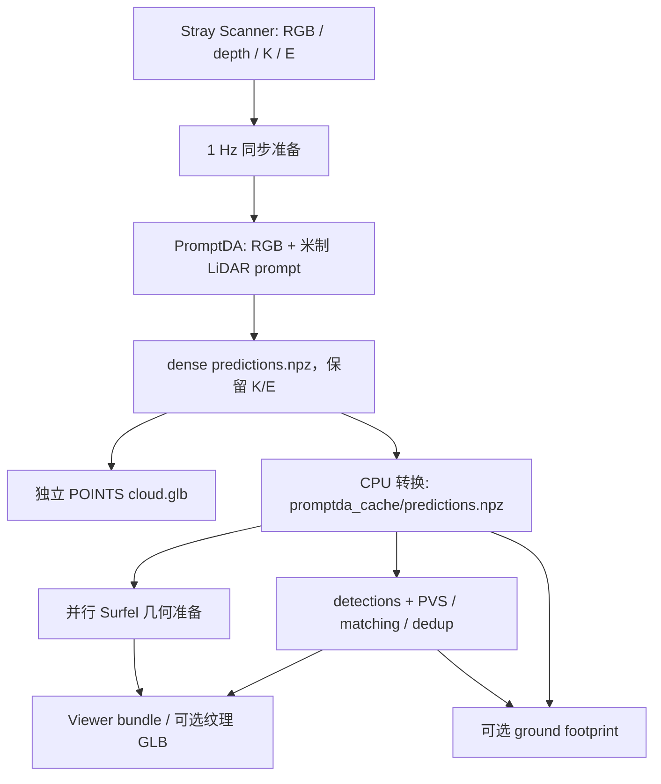

# PromptDA + LiDAR 接入共享三维流水线

本接点复用 `scripts/3d/scanner/candidates.py` 中已经实现的 Scanner → PromptDA full 推理。
主流水线消费转换后的米制场景缓存，不再要求几何由 DA3 产生。默认 backend 仍为 DA3。

## 两层入口与数据流

| 入口 | 输入 | 负责的工作 | 输出 |
|---|---|---|---|
| Scanner 独立重建 | RGB、原生 LiDAR depth、逐帧 K/E | 每秒取最近一帧，PromptDA 逐帧预测，再用 K/E 反投影；不运行 SKU matching | 原始 `predictions.npz`、POINTS `cloud.glb`、`run.json` |
| CPU 缓存转换 | 上一步的 dense NPZ、同一组原图 | 保留深度与相机，补齐世界点、帧身份、原图到处理网格的 affine | `promptda_cache/predictions.npz`，schema-v3 |
| 根 CLI 下游 | 转换后的缓存、原图、detections | `--match_backend promptda` 选择几何数据源，执行 PVS、matching、dedup、Viewer 或 footprint | matching/PVS cache、去重结果、Viewer bundle、面积报告 |

LiDAR depth 是 PromptDA 的网络输入；相机 K/E 用于输出深度的反投影，模型不接收 K/E。
完整 LiDAR prompt 的有效值保留原始米制数值，包含 confidence 0/1/2，不以高置信度筛选缩减输入。
输入文件、时间对齐、坐标约定和 DA3 尺度修复详见 [Stray Scanner 与 LiDAR 数据流](stray_scanner_lidar.md)。



图中的并行只发生在场景缓存就绪后的几何准备与 matching 之间。独立 Scanner GLB 是彩色点云；
下游纹理 GLB 由 Viewer bundle 另行导出，两者的表示、采样规则和耗时范围不同。

## 原实现提供了什么

| 信息 | 原始 Scanner PromptDA 产物 | 共享缓存适配 |
|---|---|---|
| 相机 Z 深度 | `depth[F,H,W]`，米 | 保留数值，补成 matching 所需的 `[F,H,W,1]` |
| 处理后 RGB | `processed_images[F,H,W,3]`，uint8 | 保存为 `images`，不重新 resize |
| 相机内参 | `intrinsics[F,3,3]`；当前1008模式使用实际resize半像素变换，原图模式保留source K | 保存为 `intrinsic` |
| 相机外参 | `extrinsics[F,3,4]`，可信 Scanner OpenCV world→camera | 保存为 `extrinsic`，不重新估计位姿 |
| 帧身份 | 原始 `frame_ids`，不要求连续 | 保存为 `image_ids`，消费时按 ID 对齐 |
| 尺度 | `is_metric=1`，LiDAR 米制 prompt | 不拟合新尺度，转换的 `scale_factor=1` |
| 世界点 | 未保存完整逐像素网格 | 用 K、Z、E 反投影，保留 `[F,H,W,3]` 网格 |
| 原图尺寸与 affine | 当前 NPZ 记录处理策略、1008长边与网络尺寸 | 从指定原图补齐实际resize affine；原图模式为identity |
| confidence | 没有原生 confidence 输出 | 显式 `confidence_kind=validity`，1 表示有效深度，不能解释为预测确定性 |

世界点计算：`camera = inverse(K) × [u,v,1] × depth_z`，随后用 `inverse(E)` 变换到世界坐标。
几何不经过原 POINTS GLB 的百万点采样或显示坐标变换。已有 GLB 不能代替原始预测 NPZ。

当前默认 RGB 策略为 `promptda_resize`、`preprocess_resolution=1008`：float32 RGB除255后按
官方AREA规则resize，本扫描`1920×1440 → 1008×756`，不裁边、无需补边。
网络读取未量化回uint8的float32 resize结果；保存RGB以`rint(*255)`打包，供PVS做相同处理。
K使用`A_resize @ K_source`，source→processed affine为
`[[0.525,0,-0.2375],[0,0.525,-0.2375]]`；LiDAR仍为原生256×192米制网格。

`--promptda-max-size 0` 保留此前`promptda_native_pad14`原图模式：右/底补边后裁回原尺寸，
K保留原值、affine为identity；有补边时LiDAR先按像素中心最近邻扩展到RGB网格再同步补边。
既有504缓存及无policy/resolution字段的早期原始NPZ保留原504契约，不会自动升级分辨率。
1008原始NPZ必须显式记录method和resolution，不从数组大小猜测处理策略。
转换器按声明的策略检查网格和 RGB，拒绝未知策略；仍使用 footprint 已有的原图绑定。
带 DA3 原生 `conf`/`scale_factor` 的预测不能当作当前 PromptDA 原始产物转换。

## 运行方式

所有命令从仓库根目录执行。先按 [Scanner 环境与模型说明](../scripts/3d/scanner/README.md#环境和模型)
准备本地 PromptDA 官方源码和 Large checkpoint；推理需要 CUDA，转换阶段只用 CPU。

### 1. 只生成 PromptDA 点云

```bash
uv run python scripts/3d/scanner/prepare_scanner.py \
  fd-videos/572dd9f6fb Output/scanner_prepared

CUDA_VISIBLE_DEVICES=2 uv run python scripts/3d/scanner/reconstruct.py \
  --base Output/scanner_prepared --candidate promptda \
  --promptda-repo runtime/PromptDA --checkpoint runtime/models/promptda/vitl/model.ckpt \
  --output Output/scanner_promptda_full --device cuda:0
```

准备目录和推理输出目录须为新目录；已有 prepared 数据可直接复用，不重复抽帧。
这条路径生成 `Output/scanner_promptda_full/{predictions.npz,cloud.glb,run.json}`，不需要 detections。
`CUDA_VISIBLE_DEVICES=2` 只是选择物理 GPU 的示例，进程内仍使用 `cuda:0`。

### 2. 将 dense 预测接入 SKU 流水线

dataset 按主流水线约定提供 `images/` 和 `detections_results/`。`images/` 必须使用该次推理的
同一组原图，例如准备目录 `frames/` 中的 PNG；数字文件名保留原始 frame ID，不重新连续编号。
转换器会核对实际 RGB，不能用重新编码的 JPEG 替代原 PNG 后假定二者一致。
检测框仍在原图空间，处理网格坐标由缓存里的 affine 映射。

建议不同 backend 使用独立 `--save_root`，因为 matching 后的 dedup/global mapping 与面积发布仍按 dataset 管理。
以下示例中 dataset 名称为 `scan`：

```bash
uv run python -m src.promptda_cache \
  --prediction Output/scanner_promptda_full/predictions.npz \
  --source-images-dir imdata/scan/images \
  --output Output_promptda/scan/promptda_cache/predictions.npz

uv run python main.py --mode pipeline --algorithm 3d \
  --dataset imdata/scan --save_root Output_promptda --match_backend promptda \
  --viewer-web-output runtime/promptda-viewer

uv run python main.py --mode ground-stack-area \
  --dataset imdata/scan --save_root Output_promptda --match_backend promptda
```

转换为 CPU 操作，使用未压缩 `np.savez`，拒绝覆盖已有目标。不加载 PromptDA、SAM 或 DA3 模型。
主 pipeline 中 PromptDA cache miss 会给出转换命令并停止；模型推理仍由已有 Scanner 工具负责，
不添加根 CLI 的第二套 PromptDA 模型 loader。`promptda` 是共享场景缓存的 matching backend，
不是 `--recon_backend` 的选项；不要用 `--mode reconstruct --recon_backend promptda` 启动它。
pipeline 示例保留现有本地分类流程；已有 enriched detections 时可加 `--no-classifier`，
外部分类字段仍须满足根 [README 的分类契约](../README.md#personalcare-classification-in-viewer-objects)。

此时相关输出为：

```text
Output_promptda/scan/
├── promptda_cache/predictions.npz
├── output_3dmapping_promptda/
├── sam3_mask_cache_promptda_sam31_pvs/v2/
├── dedup_detections/global_mapping.json
└── ground_stack_footprint/CURRENT   # 独立面积阶段成功或拒绝的报告
runtime/promptda-viewer/             # pipeline 的 --viewer-web-output
```

pipeline 的 `--viewer-web-output` 发布完整 Surfel bundle，不自动生成纹理 GLB。
将下面的 `RUN_ID` 替换为 `runtime/promptda-viewer/CURRENT` 中的 `run_id`，再运行已有
[Surfel GLB 导出接口](surfel_glb.md)：

```bash
uv run python -m src.surfel_glb \
  runtime/promptda-viewer/runs/RUN_ID Output_promptda/scan/scene.glb
```

GLB 输入为 generation 目录或根级包含 manifest 的 bundle ZIP，不能直接传 Viewer 发布根目录。
`main.py --mode viewer-web` 当前默认只导出 points bundle；需要此处的完整 Surfel 时使用上述
pipeline `--viewer-web-output` 路径。自定义 Viewer 输出目录也不会自动由 Vite 的 `/data/` 提供。

## 下游接口与并行

- `utils/scene_backend.py` 显式登记已接入的 DA3、PromptDA 米制网格能力，保留真实 backend 标识。
- `prepare_web_viewer_geometry(..., backend="PromptDA")` 与 matching 并行计算原始几何、共享 NN/SOR 和纹理。
  最终标签、商品保护、proxy DBSCAN、背景平面清理、预算和采样仍在 matching/dedup 完成后应用。
- Viewer 导出、prepared geometry 和 GLB 校验实际 backend，不能用 DA3 的 prepared 数据冒充 PromptDA。
  现有公开参数名 `da3_cache_path` 保留，但其内容由显式 backend 选择。
- PVS 仍由 matching 生产，先绑定缓存的实际网格与 affine；1008/504缓存使用相同的AREA processed RGB，
  原图缓存直接保留原RGB。不同网格不得复用processed masks。
  默认缓存目录为 `sam3_mask_cache_promptda_sam31_pvs/v2`，DA3 原目录保持不变。
  显式 `--sam3_mask_cache_root` 需在生产和消费两端保持一致。
- PromptDA 场景的两道深度采样 confidence 阈值默认0，采用 `>0` 有效性判断，不复用 DA3 的1.5阈值。
  深度范围、有效采样点数等几何门仍按 matching 配置生效，有效性为1不代表必然接受该点。
  这些阈值不改变 PVS 原生 presence/stability 筛选。
- footprint 按 backend 选择缓存及预处理验证；米制、原图绑定和完整 PVS mask 要求保留。
  `run_da3_footprint` 的已有函数名保留，新增 `backend="promptda"`，可显式传入 `cache_path`。
  面积算法不变，报告保留真实 backend 的 metric/processed-space 标识。
- 纹理 GLB 的 LOD、量化、JPEG 边界、Surfel 长边限制、GPU bake 和有界编码机制共用。
  输入 bundle 的 `manifest.backend` 为 `PromptDA`；前端现有 string backend 字段可直接显示。

## 性能与显存的适用范围

2026-10-19 早期同卡、同 14 帧、两路均为 504×378 的对比见 [历史候选 profiling](../scripts/3d/scanner/profiling.md)。
DA3 + K/E 修复版与 PromptDA full 的热态完整请求中位数为 1.340 / 1.674 s，
含模型的 PyTorch allocated 请求峰值为 11.336 / 1.680 GiB。前者为 BF16 autocast 多帧联合推理，
后者为 FP32 逐帧推理；这些数值不能解释为相同精度、相同 batching 的纯网络对比。
这些历史数值不适用于当前1008长边；最新实测见[1008 profiling](../scripts/3d/scanner/profiling_1008.md)。

当前默认1008×756、FP16/batch2，14帧完整热态请求中位数为1.792s、allocated请求峰值3.863GiB。
FP32/batch1对照为3.618s/2.881GiB；同期DA3维持504×378，为1.334s/11.336GiB。
另用同一个常驻模型与同一allocator交错复测，FP16 batch2/8仅差约0.2%，batch14更慢，
不能将更大batch视为必然加速。当前重建、Python调用与profiling入口统一默认采用FP16/batch2。

此前原图阶段FP32热态14帧中位数21.326s；显式FP16 autocast、batch2为5.268s，
对应 allocated 请求峰值7.146/9.064GiB。原图FP16相对FP32的平均深度差0.350mm、P99为2.071mm，
少量像素最大125.082mm；这是数值差异，尚不构成独立深度或面积精度结论。
这组batch2是原图阶段的保守测试，不代表当前1008配置的最优batch，完整历史见[原图profiling](../scripts/3d/scanner/native_profiling.md)。
当前默认参数为`--promptda-max-size 1008 --promptda-precision fp16 --promptda-batch-size 2`；
FP32对照仍可显式指定`--promptda-precision fp32 --promptda-batch-size 1`。
PromptDA 原始预测默认无压缩保存；`--compress-prediction` 以额外CPU时间缩小NPZ，数值不变。

完整请求含 RGB 解码、预处理、H2D、计算、D2H 和 CPU 结果打包，排除模型加载、抽帧和下游 SKU 流程。
PVS/matching 的历史 driver 采样峰另见 [统一 profiling 第 9 节](profiling_breakdown.md#9-显存与ram阶段峰模型参数当前占用allocator峰分开)，
其口径不同，不能与上述 allocated 峰值相加，也不能据此承诺 PromptDA 整条流水线的总峰值。

## 验证范围与限制

[Scanner 测试](../test/test_scanner_candidates.py)检查抽帧、相机、metric depth/E、完整 prompt、
resize K 和 POINTS GLB；该入口已完成七项 CPU 测试及本扫描的真实推理、GLB 回读，记录见上述 profiling。
[共享缓存测试](../test/test_promptda_cache.py)定义反投影、米制/帧顺序、官方 resize、半像素坐标、
有效性语义、matching 深度采样、PVS 输入和缓存隔离的 CPU 检查。
本次共享缓存接入的定向 CPU 检查已通过：缓存适配 11 项、Viewer/GLB 21 项、footprint 9 项，
另有 pipeline、matching/PVS 和 CLI 路由检查。Viewer/GLB 检查包含 prepared/serial 输出一致性与
实际 CPU 纹理 GLB 编码；面积检查包含合成场景的可接受结果和错误预处理的拒绝。

复用已有真实预测完成了 14×378×504 网格转换，共 2,667,168 个点；depth、RGB、K/E、frame IDs
保持原值，14 帧 PVS processed RGB 与候选输入一致。42 个选取点的相机往返误差最大为
6.11×10⁻⁵ px 和 2.39×10⁻⁷ m，这验证数据格式与变换公式，不衡量重建精度。
该真实缓存还完成 CPU 几何、NN/SOR 与纹理准备，并通过 footprint 输入校验；准备耗时 9.248 s，
是共享主机上的单次组件计时，不代表完整流水线耗时或加速比例。
接入记录位于 `runtime/promptda-decoupling-20261019/{native-cache-check,prepare-smoke}.json`。
上述共享缓存接入记录属于早期504网格。原图版本另完成32项定向CPU检查及本扫描的模型推理、
profiling和GLB回读，详见原图profiling；真实扫描缺少商品标签，未验证最终商品matching、面积或渲染画面。

接口接入不代表重建质量或面积精度得到验证。既有 DA3 性能数字不直接适用于 PromptDA；
新 backend 的完整检测→匹配→交付耗时、视觉效果和 GPU 峰值需要在有真实商品标签的数据上测量。
完整 LiDAR 已进入 PromptDA 输入，与同一份 LiDAR 的误差只能描述输入一致性，不能作为独立精度评估。
