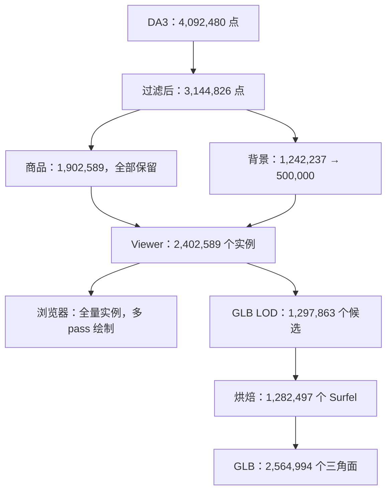

# Viewer / GLB 导出算法与提前采样诊断

核对日期：2026-10-17。本文描述当前工作区从 DA3 输出到 Viewer/GLB 的实际算法，包含尚未提交的 Surfel 提前准备代码；不表示这些实现已部署。协调者与三个 medium 只读 subagents 分别核对点数和前端、过滤和采样、GLB 循环。本文没有新增 benchmark，所有时间沿用已有记录。

同日后续实现了 NN/SOR raw 提前准备、atlas 2/4 线程以及默认关闭的 proxy/early-background 候选；文中点数与耗时仍是此前记录，不是新候选结果。新增功能测试和未完成验收见 [本轮状态](../reports/viewer-latency-20261017/STATUS.md)。

正式计时口径以 [profiling_breakdown.md](profiling_breakdown.md) 为准。下文把源码事实、日志记录和推导分开；独立组件诊断不能相加替换正式全链路。

## 1. 最终到底用多少点

对 video3 的完整 29 帧 generation，默认网页使用 Surfel bundle，不直接加载这里的 GLB。

| 阶段 | 点数 / 元素数 | 性质 |
|---|---:|---|
| DA3 native grid | 29 × 504 × 280 = 4,092,480 点 | 网格尺寸的算术结果 |
| 几何过滤输入 | 4,092,480 点 | 正式日志记录；本次所有网格点均有效 |
| 几何过滤输出 | 3,144,826 点 | 正式日志记录 |
| 其中商品 | 1,902,589 点 | 本次全部受到保护并保留 |
| 其中背景 | 1,242,237 点 | 过滤总量减商品点的推导 |
| 背景 voxel 后、预算前 | 未记录 | 不能从最终数反推 |
| 商品预算采样后 | 1,902,589 点 | 小于 2,000,000 预算，本次没有删除商品点 |
| 背景预算采样后 | 500,000 点 | 正式日志记录 |
| Viewer 发布 / 浏览器完整加载时的实例数 | **2,402,589 个 Surfel** | 发布数有运行记录；全量加载为源码推导，未做浏览器实测 |
| GLB 独立 LOD 后 | 1,297,863 个候选 | 不回写 Viewer 的点集 |
| GLB 有效烘焙后 | 1,282,497 个 Surfel | 另跳过 15,366 个没有有效可见纹理的候选 |
| GLB 三角面 | 2,564,994 个 | 每个有效 Surfel 两个面 |
| GLB atlas | 31 页 | 最终文件 121,513,344 bytes，约 115.88 MiB |

正式日志：[core.log](../runtime/video3-full-profile-20261016/core.log)，关键行 1174–1175；可移植结果：[pipeline-summary.json](../reports/cpu-latency-20261016/results/pipeline-summary.json)，含 Viewer 发布结果与 GLB report；GLB 新对照：[official.json](../reports/cpu-latency-20261016/rgb-full-validation/official.json)。

过滤前背景可推导为 4,092,480 − 1,902,589 = 2,189,891 点，前提是默认配置的商品保护在每次几何筛除时都生效。商品保护由过滤源码确认；日志记录过滤后商品全部通过预算阶段。几何过滤删除 947,654 个背景点，随后 voxel/预算阶段合计再删除 742,237 个背景点；当前记录没有区分后两者各删除多少。

独立 CPU 诊断的过滤输出是 3,365,743，不能代替正式运行的 3,144,826。两次最终都得到 2,402,589 点，不表示中间过滤完全相同。



## 2. 数据结构和执行顺序

记 `F=29, H=504, W=280, N=F*H*W`。`f` 是缓存帧槽位，不等同于视频原始帧号；`image_ids[f]` 保存其关联。

```text
world_points : float32[F,H,W,3]   世界坐标，保留原图格点关系
confidence   : float32[F,H,W]     重建置信度
images       : uint8[F,H,W,3]     processed RGB；高分辨率纹理另读原始照片
extrinsic    : float64[F,3,4]     world -> camera，记 E=[R|t]
intrinsic    : [F,3,3]            processed grid 的 K
affine       : [F,2,3]            source image -> processed grid
U,V          : float32[F,H,W,3]   一像素局部切向量，不是纹理 UV 坐标
depth        : float32[F,H,W]     相机空间 Z
source_index : int[N_selected]   原始 flatten 网格索引，连接所有输出数组
label        : int[M]            每 observation 一个标签；背景 -1
region       : int[F,H,W]        跨帧 global ID 分组；背景 -1；无效 -2
scale        : float[N_selected,2] 选点密度补偿与边界约束后的 U/V 缩放
```

来源：[DA3 cache loader](../src/web_viewer_export.py#L338)、[Surfel 序列化](../src/surfel_export.py#L88)。

当前主流程的依赖是：

```text
DA3 产生或复用 predictions.npz
    |
    +-- 一个 CPU worker：读取缓存 -> U/V/depth -> JPEG/相机准备
    |                    不读 masks，不发布 Viewer
    |
    +-- matching/PVS -> 分类 join -> dedup -> global_mapping.json
                              |
等 prepared future 完成 <-----+
    |
最终 Viewer export -> generation 目录 / CURRENT
    |
后续 delivery：ZIP；GLB 读取该 generation 并转换
```

正式运行中 preparation 为 2.999 秒，全部与 matching 重叠。最终导出仍要等待标签；不能把整段导出称为已并行。入口：[main.py](../main.py#L1087)。

`main.py` 这段流程负责生成 Viewer generation；ZIP与GLB由后续调用方的交付路径执行。本文计时采用已测的“包含ZIP和GLB”路径，不表示每个CLI命令都默认生成这两项。

## 3. 提前准备：完整原始 grid 上的一像素几何

代码：[grid_tangents](../src/surfel_export.py#L11)、[prepare_surfel_textures](../src/surfel_export.py#L48)。这是 NumPy/Pillow 路径，没有重新运行 DA3 或 SAM。

```text
depth[f,y,x] = (R[f] @ P[f,y,x] + t[f]).z
valid_grid = finite(P) AND any(P != 0) AND finite(depth) AND depth > 0

for axis in [x, y]:                         # 2 次全 grid 向量化处理
    forward  = neighbor(+1) - P
    backward = P - neighbor(-1)
    f_ok = 本点和 +1 邻点都 valid，且不跨越图像边界
    b_ok = 本点和 -1 邻点都 valid，且不跨越图像边界
    limit = max(0.03 * depth, 0.001)
    f_ok &= norm(forward)  < limit          # 比较世界坐标步长
    b_ok &= norm(backward) < limit
    tangent = 较短的有效单边差分
    若两侧都无效：tangent = [0,0,0]
    U 或 V = float32(tangent)

valid_export = finite/nonzero(P) AND finite(confidence) AND depth > 0
if prepare_filter AND !early_background_candidates:
    raw_filter = prepare_scene_filter(P[valid_export], filter_config)
    # 初始NN中位数与SOR原始mask，不应用商品保护/guard/DBSCAN/ground
else:
    raw_filter = None                      # 等标签后在最终过滤域计算

for f in 0 .. F-1:                          # 本次 29 张照片
    打开 source JPEG -> RGB
    核对照片尺寸与该帧 cache 对应
    按朝向限制到最长边 texture_edge，短边上限 min(texture_edge,1080)
    LANCZOS thumbnail                       # 默认 texture_edge=1920
    JPEG encode quality=95, subsampling=0
    保存 K、E、source_size、texture_size、inverse(source_to_processed_affine)
```

这里的全 grid 是后续识别真实深度断裂、计算局部面片和纹理回投的依据。可以只选择部分 Surfel 进行绘制，同时保留完整的 `depth`；不应把没有选为 Surfel 的格点直接改成无效深度。

## 4. 场景摆正与居中

代码：[get_scene_orientation](../utils/scene_orientation.py#L235)、[fit_scene_orientation](../utils/scene_orientation.py#L36)、[world_to_view](../src/web_viewer_export.py#L988)。

```text
若 scene_orientation.json 的算法版本和 NPZ stat identity 匹配：复用
否则：
    从 NPZ 再读取 points/confidence/extrinsic
    选 finite XYZ、XYZ 非零、finite confidence 的点
    最多等距索引选 200,000 个点进行方向拟合
    median_nn = 这些方向样本的最近邻距离中位数
    dist = clip(3*median_nn, 0.02, 0.15)
    for candidate in 0..7:                  # 最多 8 个平面候选
        在 remaining 样本上 RANSAC(dist, 3点, iterations=1000)
        法向退化：去掉其内点，再找下一个
        按相机均值位置统一法向正负
        接受需要同时满足：
            内点 >= 原始方向样本数的 5%
            相对预期方向的 tilt <= 60 度
            原始样本落在平面下方超过 0.1m 的比例 <= 15%
        接受：计算朝向 +Y 的最短弧旋转并结束
        不接受：去掉该候选内点，继续
    保存 fitted 或 not_found 结果及缓存 identity

在几何过滤后、预算采样前：
    translation = -median(filtered_points @ rotation.T, axis=0)
    world_to_view = [rotation | translation]
```

正式方向阶段 3.749 秒。方向拟合已使用最多 20 万点；不能说所有 RANSAC 都在 409 万点上运行。后面的地面过滤是另一套 RANSAC，目的是删除地面，使用不同点集和接受条件。预算采样与默认关闭的 ownership 不改变这里用于居中的 `filtered_points`。

## 5. 标签、边缘与两种不同的 spacing

代码：[标签生成](../src/web_viewer_export.py#L686)、[特征入口](../src/web_viewer_export.py#L508)、[EdgeAdaptiveSampler](../src/surfel_sampling.py#L99)。

```text
flat_P[N,3], flat_conf[N], flat_RGB[N,3] = flatten native grids
valid = finite(P) AND any(P != 0) AND finite(confidence) AND depth > 0
valid_indices[M] = flatnonzero(valid)
P_valid[M,3] = float64(flat_P[valid])

按数值 global ID 排序，建立 observation -> instance label
for 每一帧:
    读取 matching 发布的 canonical processed SAM masks
    for 该帧的每个商品 observation:
        对尚未归属的 mask 像素填入该 observation label
        重叠像素保留先填入的 label
labels[M] = dense labels 在 valid_indices 上的值
label_keys[label] = (global_id, instance_index)

regions[N] = -2
regions[valid_indices] = -1
regions[商品点] = 跨 observation、跨帧相同 global ID 的分组号

steps = 每16个 valid_indices 选一处的 ||U|| 和 ||V||
spacing_grid = median(steps 中正且有限的值)
若没有这样的步长：spacing_grid = 0
```

`spacing_grid` 来自 native grid 的切向量，用于自适应采样和 footprint。它不同于几何过滤里 Open3D 在全部有效点上计算的 `median_nn`。也不同于 SOR 的 `k=20` 邻居统计。三者不能随意互换并声称等价。

默认自适应特征逐帧执行：

```text
for f in 0 .. F-1:
    for axis in [x,y]:
        pair_valid = 两个相邻像素都有效
        jump = abs(depth_neighbor - depth_here)
        neighbor_slope = 邻接同轴 pair 中较小的有效深度差；缺失时0
        blocked = NOT pair_valid
                  OR jump > max(2*spacing_grid, .005*min(depth_pair))
                            + 3*neighbor_slope
                  OR region_neighbor != region_here

    edge = blocked 两端的像素 OR 图像四边；再与 valid 相交
    halo = edge 膨胀2轮；再与 valid 相交
    weight = 边缘4，halo2，内部1，无效0

    for axis in [x,y]:
        向两个方向累计到最近 blocked 或图像边界的距离
        cap_axis = clip(distance * (.95/1.05), .5, 8)

输出 weights[N] uint8 与 caps[N,2] float32
```

这里需要完整深度与标签邻接，目标是保留薄边、真实深度断层和相邻商品边界。先删掉未显示点、再以剩余稀疏 grid 识别断裂，会把人为抽样空洞当成场景空洞。特征构造独立诊断为 0.448 秒，优先级低于 DBSCAN。

## 6. 几何过滤：全量点估计，逐阶段保护商品

代码：[filter_scene_points](../utils/pointcloud_filter.py#L47)。这里描述项目实际调用及 guard；Open3D 内部算子不等于 Python 中存在逐点循环。

```text
protected = labels >= 0
base = finite XYZ AND XYZ 非零
protected &= base
if !enabled OR count(base) < 1000:
    return base

current_indices = flatnonzero(base)
pcd = Open3D PointCloud(float64(P_valid[current_indices]))
median_nn = median(pcd.compute_nearest_neighbor_distance())
if median_nn <= 0:
    return base

function apply(raw_keep):
    stage_keep = raw_keep OR protected[current_indices]
    if count(stage_keep) < .20 * len(current_indices):
        跳过整个阶段，保留原 current_indices/pcd
    else:
        更新总 keep mask
        current_indices = current_indices[stage_keep]
        pcd = pcd.select_by_index(flatnonzero(stage_keep))

# A. SOR
if len(current_indices) > 20:
    kept_indices = pcd.remove_statistical_outlier(k=20, std_ratio=2)
    apply(mask_from_indices(kept_indices))

# B. DBSCAN，默认开启
if len(current_indices) >= 10:
    cluster_labels = pcd.cluster_dbscan(eps=5*median_nn, min_points=10)
    对非噪声 labels 计数
    big = 簇大小 >= .01 * len(current_indices) 的簇
    if big 为空但存在非噪声簇:
        big = 最大簇
    raw_keep = cluster_labels 属于 big
    apply(raw_keep)                         # 全noise也执行保护/guard

# C. 地面 RANSAC，默认开启
if len(current_indices) >= 1000:
    dist = clip(3*median_nn, .02, .15)
    plane, inliers = pcd.segment_plane(dist, ransac_n=3, num_iterations=1000)
    if len(inliers) >= .08 * len(current_indices):
        rest = 非内点
        signed = rest @ plane.normal + plane.offset
        positive = count(signed > dist)
        negative = count(signed < -dist)
        if min(positive,negative) > .15*len(rest):
            不删：最大平面可能穿过主体
        else:
            apply(非内点 mask)
return 总 keep mask
```

容易误解的细节：

- 商品点参与所有几何估计，只在应用删除结果时获得保护；当前不等于只对背景运行过滤。
- `median_nn` 在初始点集计算一次，SOR/DBSCAN/RANSAC 后不重算。
- DBSCAN 的 1% 相对于本阶段全部输入点数；不是 footprint 多分量规则中的“相对最大分量20%”。
- `min_remaining_ratio=.2` 相对于各阶段当前点集，不能解释成最终必须保留原始点的20%。
- 商品保护可使 `apply` 的保留比例上升；提前采样会连 guard 是否触发也一起改变。
- RANSAC `num_iterations=1000` 是上限；v0.19.0 内部按 probability/fitness 自适应跳过后续假设，详见6.1。

2026-10-17 的调度实现将 NN 与 SOR 原始 mask 提取为 `prepare_scene_filter()`；完整 Surfel 准备任务会在 matching 同时计算它们。`filter_scene_points(..., prepared=...)` 在同一 float64 点域、顺序与配置下复用 raw 结果，随后仍按上面的 `apply()` 合回商品保护、检查 guard，再运行 DBSCAN 和地面删除。同步调用也走同样逻辑。它改变计算时机，不移除默认全量过滤；准备结果还保留点快照和原始 Open3D cloud，会增加驻留内存。真实重叠收益未测。

proxy 模式由 `PointCloudFilterConfig(cluster_proxy_voxel_scale=...)` 显式开启，默认 `0`。voxel 边长为初始 `median_nn*scale`，每格取最早原始成员，保留成员映射；只在 SOR 之后的代理点上 DBSCAN，再将标签映回全部成员。1% 簇大小和 guard 按原始成员数判断；10 邻居核心门槛仍按代理点计数，邻接语义有变化，不能称为等价加速。

独立过滤诊断：NN 3.811 秒，SOR 整段 7.418 秒，DBSCAN 整段 43.396 秒，地面整段 11.708 秒，其他 0.512 秒，总计 66.845 秒。正式运行的对应过滤区间是 60.096 秒，不能把两套数字拼到一起。

默认关闭的实验分支位于过滤之后、预算采样之前：`quality_filter`、`product_spill_trim`、`single_owner`。来源：[ViewerExportTuning](../src/viewer_export_tuning.py)、[调用次序](../src/web_viewer_export.py#L575)。本文不展开默认关闭的 quality/spill 内部算法。

`single_owner` 开启时还会按世界位置、法向类别、语义 region 划 patch，按视线角度、距离、confidence 全体秩和帧清晰度汇总每 frame 分数，选择 patch 最佳来源帧，再对空掉的 fine voxel 补回来源；因此它也依赖完整候选集合，不能在提前抽稀后直接声称等价。默认 patch 为 `4*spacing_grid`，fine voxel 为 `spacing_grid`。来源：[surfel_ownership.py](../src/surfel_ownership.py#L99)。

### 6.1 Open3D 0.19.0 原生循环

以下经官方固定版本源码核对，用于解释算子实际在循环什么，不是新增性能测量。Python 文件只展示调用，不能据此误以为内部没有大循环。

NN/SOR 来源：[PointCloud.cpp](https://github.com/isl-org/Open3D/blob/v0.19.0/cpp/open3d/geometry/PointCloud.cpp#L570)。

```text
compute_nearest_neighbor_distance(pcd):
    点数<2时返回全0
    tree = 新建 KDTreeFlann(pcd)
    OpenMP static parallel for i in 0..M-1:
        indices, squared_distances = tree.SearchKNN(P[i], 2)
        返回点数<=1：distance[i]=0
        否则 distance[i]=sqrt(squared_distances[1])
    Python 端再 median(distance)

remove_statistical_outlier(pcd,k=20,std_ratio=2):
    tree = 再新建 KDTreeFlann(pcd)         # 不复用上一步的树
    OpenMP static parallel for i in 0..M-1:
        squared_distances = SearchKNN(P[i],20)
        avg[i] = mean(sqrt(squared_distances))
        若没有返回邻居：avg[i]=-1
    V = 有返回邻居的查询数量
    mu = sum(avg[i] 中 >0 的项) / V
    sigma = sqrt(sum_{avg[i]>0}(avg[i]-mu)^2 / (V-1))
    kept = 原输入顺序中满足 0<avg[i]<mu+2*sigma 的点
    原生函数构造一份 selected PointCloud，并返回它和 kept indices
```

`k=20` 包含查询点自身的零距离，不是20个其他邻居。公式中的 `V` 还包含均值为0的有效查询；保留条件为严格小于，不能在重写时随意改变。原生 SOR 返回的 PointCloud 在 Python 侧被丢弃，商品保护与20% guard 后，项目又调用一次 `select_by_index`。这是可以调查的额外构造，当前 API 没有项目已用的“仅返回 mask”选项；要消除它可能需要原生接口改动。

DBSCAN 来源：[PointCloudCluster.cpp](https://github.com/isl-org/Open3D/blob/v0.19.0/cpp/open3d/geometry/PointCloudCluster.cpp#L18)。

```text
tree = 新建 KDTreeFlann(当前 SOR 应用后的 pcd)
nbs = vector<vector<int>>(当前点数)
OpenMP static parallel for i in 0..M_current-1:
    nbs[i] = SearchRadius(P[i],eps)        # 保存全体点的半径邻居列表
    # 邻居数没有 k 上限；还会在 critical 中更新 progress

labels[:] = -2                            # 未访问
cluster_id = 0
串行 for idx in 原始当前点顺序:
    if labels[idx] != -2: continue
    if len(nbs[idx]) < 10:
        labels[idx] = -1                  # noise，稍后仍可能成为边界点
        continue
    frontier = unordered_set(nbs[idx])
    visited = {idx}
    labels[idx] = cluster_id
    while frontier 非空:
        nb = frontier.begin()             # 无序集合，不是 FIFO 队列
        从 frontier 删除 nb，放入 visited
        if labels[nb] == -1:
            labels[nb] = cluster_id
        if labels[nb] != -2: continue
        labels[nb] = cluster_id
        if len(nbs[nb]) >= 10:
            for neighbor in nbs[nb]:
                if neighbor not in visited:
                    frontier.insert(neighbor)
    cluster_id += 1
```

这里同时存在三类工作：新建空间索引、对所有点查半径邻居并存储、串行维护集合和扩展簇。开更多 OpenMP 线程不能使后两者整体线性加速。邻居索引总量随 `sum_i len(nbs[i])` 增长，不只随点数增长；因此提前抽稀可能显著改变成本，也会改变邻接图与聚类结果。现有记录没有 `nbs` 总量或均值，不能把某个假设邻居数当作实测内存。

RANSAC 来源：[PointCloudSegmentation.cpp](https://github.com/isl-org/Open3D/blob/v0.19.0/cpp/open3d/geometry/PointCloudSegmentation.cpp#L133)。

```text
串行预生成全部1000组随机索引，每组内3个索引互不重复；不同组可以重复
OpenMP static parallel for itr in 0..999:
    if iteration_count > break_iteration: continue
    从3点叉积拟合平面并归一化；退化则 continue
    串行扫描当前全部点:
        abs(plane dot [XYZ,1]) < dist 时为内点
    fitness = 内点数 / 当前点数
    rmse = sqrt(内点平方距离均值)
    critical:
        若 fitness 更高，或相同 fitness 且 rmse 更低：
            更新 best
            若fitness<1：break_iteration = size_t(min(
                log(1-p)/log(1-fitness^3),1000))，默认p=.99999999
            若fitness=1：break_iteration=0
        iteration_count += 1

用 best plane 再扫描全体点，得到 final_inliers
用 final_inliers 重新拟合 plane
返回重拟合 plane 与此前的 final_inliers
```

`1000` 是上限，内部有概率/fitness 决定的自适应停止；并行区中已开始的工作也可能继续，不能将参数乘点数当作实际执行次数。返回 inliers 不再根据最后重拟合的 plane 重算。该算子不建 KD-tree，每个实际评估的平面会扫描当前点集；它与方向拟合虽然都调用 RANSAC，但输入与判定目标不同。

### 6.2 由原生循环得到的优化线索

NN 与 SOR 在同一初始有效域上分别建树和查询，是一个可调查的共享工作机会；DBSCAN 通常已经是 SOR 应用后的不同点集，不能直接把初始树当作相同输入的树。当前 Open3D 高层 API 没有在这里共享树，改成自定义查询或原生融合涉及代码维护、数值顺序与严格阈值的验收，不能只改 Python 调用顺序就宣称消除了成本。

## 7. 背景 voxel、商品预算与确定性自适应采样

代码：[商品预算](../src/web_viewer_export.py#L436)、[背景 voxel](../src/web_viewer_export.py#L476)、[候选合并](../src/web_viewer_export.py#L617)、[组内选择](../src/surfel_sampling.py#L147)。

```text
P, labels, confidence = 几何过滤后的点及对应属性
background = flatnonzero(labels < 0)
product = flatnonzero(labels >= 0)

# 背景先 voxel，商品不参加这一竞争
voxel_key = floor(P[background] / .005)      # 默认 5mm
按 voxel XYZ、confidence 降序稳定分组
每个 voxel 取最高 confidence；并列取原输入最早点
按该 voxel 首次出现位置恢复 voxel 顺序
background_candidates = voxel winners

background_selected = adaptive_select(
    background_candidates,
    budget=min(len(background_candidates),500000),
    support=全部过滤后背景点
)

if len(product) <= 2000000:
    product_selected = adaptive_select(product, budget=len(product))
    # 全保留但仍计算 scale，不是直接跳过所有 sampler 工作
else:
    按 global ID 汇总跨 observation、跨帧商品点
    remaining_budget = 2000000
    while 尚有预算和未满商品组:
        将剩余预算按未满组数量平均分配整数 share
        不超过各组容量；用不完的配额再次分配
        若 share=0，按 global ID 顺序分配最后的整数余量
    for gid in global ID 顺序:
        adaptive_select(该组全部候选,该组quota)

keep = sort(product_selected + background_selected)
source_indices = valid_indices[keep_filter][keep]
order = stable_argsort(instance_labels[keep])
所有输出属性都采用同一 source_indices 和 order
```

自适应选择是按原始图像分块的确定性过程：

```text
function adaptive_select(indices,budget,support=None):
    for 各候选原始 source_index:
        解码 frame、原始 pixel_x/pixel_y
        tile = 该frame内16×16像素块编号
        for bit in 0..3:
            把 tile 内 x/y 的 bit 交织成 Morton 顺序

    capacity[tile] = 候选点数
    mass[tile] = 候选 weights 之和
    support_mass[tile] = support weights之和；没有support时取mass

    按 mass 给 tile 分配整数 quota：
        budget够时，每个非空 tile 先保留1个
        while 还有预算:
            按未满 tile 的 mass 比例分配
            触及 capacity 的 tile 填满后移除，再分配
            对剩余份额取 floor，再按小数余量稳定分配整数

    stable_sort(candidates, key=tile*256+morton)
    for 每个 quota>0 的 tile:
        求 rate，使 p_i=min(1,rate*weight_i) 的和等于 quota
        # 已达到p_i=1的项固定，再对其余项重算rate
        按 Morton 顺序计算 cumulative_sum(p_i)
        在 .5,1.5,...,quota-.5 处 searchsorted(side="right") 选点
        density = selected_p_i * candidate_mass/support_mass
        nominal_scale = clip(1/sqrt(density), .5, 8)
        uv_scale = min(nominal_scale,该原始格点的二维 caps)

    按原候选索引稳定排序，返回 selected 与 uv_scale
```

背景已 voxel 后的候选点仍以完整过滤后背景作为 support，目的是让 footprint 补偿真实抽稀比例。不能只用稀疏候选重新估计有效域。商品没有超预算时也可能因边界 cap 收缩 footprint，不能把“全部保留”理解成所有 scale 必定等于1。

预算保护与几何保护是不同概念：商品几何过滤保护不等于商品总数超过 2M 时也无限保留。当前硬预算是商品最多2M、背景最多500K，因此通常 Viewer 最多2.5M点；实际小于预算时使用实际点数。此处都是导出预算，不是前端屏幕空间 LOD。

## 8. 序列化与 ZIP

```text
用最终 source_indices gather U/V/scale、frame_id = source_index//(H*W)
positions -> Float32[N_selected,3]
normals -> Int8[N_selected,3]               # 当前为固定安全方向，不是昂贵法线拟合
colors -> Uint8[N_selected,3]
U,V -> Float16[N_selected,3]
scale -> Float16[N_selected,2]
frame -> Uint8[N_selected]
depth -> Float16[F,H,W]                    # 深度仍是完整grid，不随Surfel采样缩小

for 每个 observation label:
    对已按label排序的数组 searchsorted，写 point_index_range
整理 objects、world_to_view、display_bounds、manifest、缩略图
在临时generation目录写文件
rename为正式generation，再原子替换CURRENT
```

来源：[prepare_surfels](../src/surfel_export.py#L88)、[publish](../src/web_viewer_export.py#L1016)。Viewer 的 U/V 是局部世界坐标切向量，GLB 后面生成的 UV 则是二维 atlas 纹理坐标；两者含义不同。

ZIP 只封装现有文件：8 个二进制使用 DEFLATE level1，JSON/JPEG 使用 STORED。正式 2.752 秒；独立诊断中 8 个二进制占 2.992 秒，740 张 JPEG 占0.113秒。JPEG 已经压缩，当前没有再次对其做 deflate。ZIP 不重新运行重建、过滤或采样。

## 9. GLB：独立于 Viewer 的保守 LOD

生产入口：[export_scene_glb](../src/surfel_glb.py#L299)。默认 `radius=2, tile_size=8, lod=True, palette_colors=128`；内部 `atlas_size=2048, batch_size=1024`。独立 CLI 的 LOD 默认关闭，不能与生产入口混淆。

先读取 Viewer positions/U/V/scales/frame/depth/照片和相机信息，建立每点的 object ID：商品由 `objects.json` 的 `point_ranges` 赋值，背景为 -1。当前 GLB 没有重跑 DA3/SAM，也没有先生成一份完整未压缩 GLB 再二次转换。

代码：[select_surfel_lod](../src/surfel_lod.py#L49)、[coverage](../src/surfel_lod.py#L8)。

```text
keep[N_viewer] = True
for f in sorted_unique(frame_indices):
    slots = 本frame的原始点索引，保留原顺序
    center = P[slots] @ R.T + t
    projected = center @ K.T
    processed_xy = projected.xy / projected.z
    valid = center/processed_xy finite、center.z>0、projected.z>0、
            processed_xy在图内、object_id>=0
    candidates = flatnonzero(valid)
    若candidates为空：continue
    pixel[valid] = floor(processed_xy[valid]+.5)

    key = [object_id[candidates],pixel[candidates].x//2,pixel[candidates].y//2]
    stable_group_by(key)
    只取点数恰好4、四个角恰好覆盖[0,1,2,3]的完整2×2组
    # 缺角、重复像素、多于4点的单元保留原样

    for group_batch in 每8192组:
        # 最多32768个原点；不是8192个点
        四点法向 = normalize(cross(U,V))
        valid_group = 四法向非零
                      AND 所有法向pair的cosine>=.95
                      AND 四点camera_z极差<=.01*四点camera_z均值
                      AND 四点两轴scale都>=1
        for sample in [中心,左,右,上,下]:
            对四点查对应深度
            valid_group &= 深度finite且>0、像素在图内
                           AND abs(sampled_depth-camera_z-sign*depth_step_axis)
                               <=.001+.5*native_axis
            # 中心sign=0，左右用U轴，上下用V轴

        representative = 组内左上角原点       # 不移动中心，不平均几何
        a,b = bound_footprint(rep_U,rep_V,native)
        a *= 2*rep_scale_u
        b *= 2*rep_scale_v
        将四个原中心相对representative的位置解到a/b基底
        valid_group &= 基底可解
                       AND 四中心的s²+t²<=.9²
                       AND 离代表平面的残差<=.005*各自camera_z
        对通过组：只保留左上角，删除其余3点
return 原全局顺序中的keep索引
```

本次完整组 452,701，接受 368,242，删除 3 × 368,242 = 1,104,726 点，剩 1,297,863。背景 `object_id=-1` 不进入2×2候选，因此这次背景500,000在LOD阶段全部保留，商品从1,902,589降为797,863；这两项为源码与总数的推导，不是额外日志。

当前检查只验证四个中心的覆盖，不保证所有视角像素覆盖相同。LOD 用了 `_bound_footprint`，没有调用后面 baker 的 `_limit_final_diameter`；尝试前移或复用 LOD 到 Viewer 时，需要同时检查最终直径限制后的覆盖。仅依据“选出的点相同”不足以证明画面等价。

独立诊断 LOD 5.473 秒，其中 coverage 1.713 秒、72批。即使一个组前面的法向/深度检查已失败，当前仍对它继续做该 batch 后面的向量化检查；这是小的早退候选，尚无收益测量。

## 10. GLB：frame → batch → texel → tile → atlas

代码：[bake_surfel_pages](../src/surfel_mesh.py#L179)、[_bake_batch](../src/surfel_mesh.py#L95)。下面的 texel 运算是 NumPy 广播，不是 Python 对8200万个像素逐个调用函数。

```text
tile_size = 8
stride = tile_size+2 = 10                  # 四周各1像素border
columns = floor(2048/10) = 204
capacity = 204² = 41616 个Surfel/满页
page_corners[41616,4,3] float32
page_tiles[41616,10,10,4] uint8
filled = 0

for f in sorted_unique(frame_indices):     # 来源帧顺序
    读取JPEG并解码为 float32 RGB
    若该照片较小，零填充到所有frame的最大纹理宽高
    frame_depth[H,W] = depth[f]
    slots = flatnonzero(frame_indices==f)

    for batch in slots 每1024个候选:
        center[B,3] = P @ R.T + t
        projected[B,3] = center @ K.T
        visible = center/projected finite且z>0
        筛掉不visible候选
        若B=0：返回空 batch

        native[B,2] = max(1e-6, center.z * norm(inv(K)[:,:2],axis=0))
        bu,bv = bound_footprint(U,V,native)
        pixel[B,2] = floor(projected.xy/projected.z+.5)
        depth_step[B,2] = [U·R_z,V·R_z]
        bounds[B,4] = [-大值,+大值,-大值,+大值]

        for direction in [左,右,上,下]:
            sample = 中心像素相邻1格的depth
            continuous = 邻点在图内 AND sample>0
                         AND abs(sample-center.z-sign*depth_step_axis)
                             <=.001+.5*native_axis
            若不continuous：对应bounds设为中心像素±.5

        bu *= radius*scale_u
        bv *= radius*scale_v
        bu,bv = limit_final_diameter(bu,bv,native)

        q[8] = (arange(8)+.5)*2/8-1
        x,y[8,8] = meshgrid(q,q)
        world[B,8,8,3] = P + x*bu + y*bv
        camera = world @ R.T + t
        texel_projection[B,8,8,3] = camera @ K.T
        processed[B,8,8,2] = texel_projection.xy / texel_projection.z

        valid[B,8,8] = x²+y²<=1 AND camera.z>0
                       AND processed在完整depth网格内
                       AND processed在四邻接bounds内
        nearest = floor(processed+.5).astype(int)
        sampled_depth = depth[clip(nearest.y,0,H-1),clip(nearest.x,0,W-1)]
        valid &= sampled_depth>0
                 AND abs(sampled_depth-camera.z)<=.015*sampled_depth+.001

        affine = frame.processed_to_source
        source = processed @ affine[:2,:2].T + affine[:2,2]
        valid &= source在原始source_size范围
        valid &= norm(cross(bu,bv))>0
        keep[B] = valid在8×8中至少有1个True
        丢弃没有有效texel的候选，剩K个

        texture_xy = (source+.5)/source_size*texture_size-.5
        RGB[K,8,8,3] = 双线性照片采样          # 每个位置读4个角点并加权
        tiles[K,10,10,4] = 0
        tiles[:,1:-1,1:-1,RGB] = round(RGB)
        tiles[:,1:-1,1:-1,alpha] = valid*255
        corners[K,4,3] = P ± bu ± bv
        dilate_rgb(tiles)

        offset = 0
        while offset<K:
            take=min(capacity-filled,K-offset)
            将corners/tiles拷入page缓冲
            filled+=take; offset+=take
            if filled==capacity:
                yield assemble_page(...)
                filled=0
if filled>0:
    yield 最后不足一页
```

页面可以跨 frame 拼接。本次诊断共1,280个 bake batches；保留1,282,497个 Surfel，其RGB双线性采样覆盖82,079,808个内部位置；此前投影与valid计算还包含最终被丢弃的候选。边界/遮挡无效的 texel 目前也先进行 RGB 采样，再由 alpha 与后续 RGB 延展处理。减少这一部分计算属于候选，需要验证最终透明RGB也一致，不能只看alpha或非透明区域。

### 10.1 两道长边约束

[_bound_footprint](../src/surfel_mesh.py#L16) 在乘 radius/scale 前，把 `U/native_u, V/native_v` 组成的二维基底奇异值作限制：major上限 `min(2,4*minor)`，minor上限2，再变回原空间。

[_limit_final_diameter](../src/surfel_mesh.py#L34) 在乘 `radius*scale` 后，将世界空间 `bu,bv` 基底的两个奇异值都限制到 `3*max(native_u,native_v)`。所以最终最大直径限制是 `6*max(native axes)`；它不同于只限制某一根向量长度。

两道限制都在展开8×8世界坐标前执行。RGB延展不改变几何。旧独立诊断里 footprint和最终直径约束合计0.836秒，直接删除它的时间价值小，且会失去已有拖影限制。

### 10.2 RGB 延展的准确 loop

代码：[_dilate_rgb](../src/surfel_mesh.py#L74)。

```text
known[K,10,10] = alpha != 0
directions = [左到右,右到左,上到下,下到上]
for round in range(height+width):          # 默认上限20轮
    if known.all(): break                  # 对整个batch的检查
    old = known.copy()                     # 冻结本轮可作为来源的像素
    for direction in directions:
        fill = old[source] AND NOT known[destination]
        RGB = tiles[source,RGB][fill]       # 当前切片实现只gather待填部分
        tiles[destination,RGB][fill] = RGB
        known[destination] |= fill
return 原tiles对象
```

本轮新填的像素只能在下一轮作为来源；目的 `known` 即时更新，使方向优先级固定。alpha从未改变。早停以整个batch为单位，最慢填满的tile决定继续轮数；不能把四个方向直接并行，或让轮内新像素立即传播，再宣称语义相同。

当前每轮仍有 bool mask copy、四方向 fill mask、RGB gather与散写；此前整数组 `np.roll` 已移除。正式新对照的延展子区间约24秒，旧56秒不是当前值。

### 10.3 atlas 页面

代码：[_page](../src/surfel_mesh.py#L156)。

```text
C = min(204,count)
R = ceil(count/C)
padded[R*C,10,10,4] = 0
padded[:count] = tiles[:count]
atlas[R*10,C*10,4] = reshape/transpose(padded)

for Surfel slot i:                         # 实际为向量化arange/广播
    origin = [i%C,i//C]*10+1
    uv[4,2] = (origin+[[0,0],[8,0],[8,8],[0,8]]) / [C*10,R*10]
    indices[2,3] = 4*i + [[0,1,2],[0,2,3]]
positions[4*count,3] = corners.reshape(...).copy()
```

满页纹理实际为2040×2040；2048是上限。每页 positions有copy，UV/indices为新数组，atlas由本页新建padded产生，随后复用producer的page缓冲不会改写已交出的页面。这是异步编码可持有本页数组的依据；仍应将已提交页面视为只读。

## 11. GLB：几何量化、PNG 与单 writer

代码：[生产 page 消费循环](../src/surfel_glb.py#L244)、[_CompactWriter](../src/surfel_glb_compact.py#L106)、[encode_atlas](../src/surfel_glb_texture.py#L27)。

```text
for page in bake_surfel_pages(...,image_format="rgba"):
    # 当前同步串行：未完成以下工作前，不会恢复下一页bake
    compact.geometry(page.positions,page.uv,page.indices,page_id)
    png = encode_atlas(page.image_rgba,colors=128)
    compact.image(png)
    更新document的texture/material和计数
全部页面完成后 compact.finish(output)
```

几何量化的下层 loop：

```text
for triangle_slice in 每32766个triangle:
    pending = [triangle_slice]
    while pending 非空:
        part = pop(pending)
        vertices,inverse = unique(part.indices)
        if unique_vertices>65535:
            将part按triangle一分为二，先处理前半
            continue

        P = page.positions[vertices].float64
        low = P.min(axis=0)
        extent = P.max(axis=0)-low
        零extent设1
        qposition[V,4] uint16 = 0           # 第4项用于8-byte stride对齐
        qposition[:,:3] = round((P-low)/extent*65535)
        quv[V,2] uint16 = round(UV[vertices]*65535)
        qindex = inverse.uint16

        单writer依次写position/UV/index，写入前4-byte对齐
        追加bufferViews/accessors
        创建带low/extent transform的node和一个primitive
```

典型32766面对应16383个quad、65532个顶点。每个 Surfel 的四顶点独立，没有把相邻 Surfel 焊接成连续表面；本次1,282,497个quad对应5,129,988个几何顶点的源码推导。正式报告为93个 primitives。不能把4倍顶点数叫作4倍“场景点数”。

PNG loop：

```text
检查 alpha 只取0或255
RGB = Image.fromarray(rgba).convert("RGB")
indexed = RGB.quantize(colors=128,method=MEDIANCUT,dither=NONE)
indices = indexed像素索引
palette = 128个RGB颜色，不足补齐
indices[alpha==0] += 128
result.palette = [palette,palette]
PNG.save(transparency=[255]*128+[0]*128,optimize=True)
return PNG bytes
```

每页独立产生调色板：128个RGB颜色配合两种alpha状态最多占256个索引。透明像素的RGB也参与量化并保留，不能通过改透明RGB为黑色来省事。`palette_colors=None` 会改成 RGBA PNG，属于另一种参数选择，当前默认仍为128。

PNG bytes 写入同一临时 BIN 流，最后组装 GLB header、JSON chunk和BIN chunk。当前已有逐页直通，不生成一份中间完整 GLB，也不先PNG编码再解码后重新编码。最后写文件旧诊断仅0.096秒；几何量化与写BIN合计1.853秒，主要时间仍在图像处理。

### 11.1 两个或四个编码线程的有界候选

源码已提供 `export_scene_glb(..., encoder_workers=2/4)`，默认仍为 `1`；功能测试和完整 video3 对照均已通过。固定 4 个逻辑 CPU、完整页面捕获的两组对照中，2 线程为 70.663/70.555 秒，4 线程为 69.699/69.908 秒；相对各自串行控制均约节省 37%。所有 8 次正式导出均完成 31 页并通过完整输出相等检查。两组分别运行，不据候选均值差认定 4 线程更优，也不更新旧全链路基线。见[执行与独立复核](../reports/viewer-latency-20261017/STATUS.md#complete-atlas-comparison)。算法如下：

```text
workers = 2 或 4
executor = ThreadPoolExecutor(max_workers=workers)
pending = FIFO，最多保留workers个未消费页面（包括正在编码的页面）

function consume_oldest():
    page_id,page,future = pop_oldest(pending)
    # 以下始终由单一主线程写，按原page顺序
    compact.geometry(page.positions,page.uv,page.indices,page_id)
    png = future.result()                 # 失败直接向外传播
    compact.image(png)
    update_material_document(page_id)

for page in baker:
    # 页面交出后只读；编码worker不能调用compact/document
    enqueue(page_id,page,executor.submit(encode_atlas,page.rgba,128))
    if pending达到上限: consume_oldest()
while pending: consume_oldest()
全部成功才 compact.finish(output)

任意异常：停止生产，取消尚未开始任务，等待运行中任务收尾；不重试/降级
```

在此排队方式中，主线程先交出最多 workers 页，再等待最早一页；第一页编码可以与后续页烘焙重叠。之后按页序消费。两页或四页有界不表示编码线程始终饱和；必须看实际 pipeline 时间线。

满页输出数组持有量为 RGBA15.875 MiB、positions1.905 MiB、UV1.270 MiB、indices0.953 MiB，合计约20.003 MiB。这不包含producer固定缓冲、当前bake batch、原始照片、编码器RGB/indexed中间对象和PNG结果；是数组规模推导，不是RSS峰值。只限制worker数而无限submit不能约束内存。

当前锁定 Pillow 12.3.0 的 [MEDIANCUT](https://github.com/python-pillow/Pillow/blob/12.3.0/src/libImaging/Quant.c#L1699)和 [PNG 压缩](https://github.com/python-pillow/Pillow/blob/12.3.0/src/libImaging/ZipEncode.c#L138)主要循环有释放 GIL 的区间，因此线程具有实际并行条件。完整对照显示并行收益，但编码与 baking 也会争 CPU，当前证据不支持继续增加线程的优先级。四页原始数组约 80 MiB，不能作为总 RSS；测试 RSS 还含基线和当前页面捕获。验收固定像素/量化参数、页序、BIN 写入顺序、失败传播及完整导出边界，再比较最终语义与耗时。

## 12. 前端究竟绘制什么

代码：[loader](../modules/viewer_web/src/bundle-loader.ts#L47)、[Surfel loader](../modules/viewer_web/src/surfel-loader.ts#L65)、[实例数](../modules/viewer_web/src/surfel-renderer.ts#L232)、[render passes](../modules/viewer_web/src/surfel-renderer.ts#L333)。

```text
读取全部 positions/U/V/scale/frame/depth/照片
pointCount = positions.length/3 = 2,402,589
geometry = 共享4顶点、6索引的quad
geometry.instanceCount = pointCount        # 没有再次抽稀
每个点的属性用instanced attribute关联

每次Surfel重绘：
    front-depth pass：提交全部2,402,589个实例
    若sourceSelection开启：winner pass，同样提交全部实例
    accumulation pass：提交全部2,402,589个实例
    fullscreen composite quad

商品搜索/隐藏：
    根据objects point_ranges更新visibility attribute
    fragment中discard隐藏对象
    不缩小instanceCount，不重新压缩位置buffer
```

默认 source selection 关闭；`?surfel_source=local` 或UI开关开启才增加winner pass。它不减少已有两个pass的顶点提交。每个quad由两个三角形组成，所以默认每次重绘的两个 Surfel pass 共提交 `2,402,589*2*2 = 9,610,356` 个三角面；source selection开启时三个pass共14,415,534个三角面。这是提交规模，不是所有面最终贡献像素，更不是浏览器实测性能。

实例绘制只保留一份共享基础quad，没有在CPU把 positions复制4倍。mesh级 `frustumCulled=false`，正常GPU裁剪、深度和fragment discard仍发生。当前未统计某个相机下实际贡献像素的Surfel数。

前端调度是按需重绘：

```text
request():
    已有待执行RAF时合并请求
    下次RAF调用draw(time)
    draw返回True时再request()

draw(time):
    更新focus animation与controls
    Surfel模式执行上述passes；points模式执行composer
    return points模式 OR focus animation仍进行
```

静止Surfel不持续执行两pass；相机/controls/UI变化会请求重绘。points模式持续RAF。来源：[render-loop.ts](../modules/viewer_web/src/render-loop.ts#L5)、[scene.ts](../modules/viewer_web/src/scene.ts#L359)。拾取操作还可能额外执行pass，不计入上述基础两pass。

UI的 `Matching … of …` 是搜索匹配的 global ID 数量，不是点数或屏幕可见点数。[main.ts](../modules/viewer_web/src/main.ts#L423)。因此需要分别讨论：加载点数、GPU提交实例数、通过可见性规则的点数、最终贡献像素的点数；目前只有前两者可由这些数据与源码确定。

## 13. 为什么不一开始下采样：依赖与可重设计之处分开

**不存在“Surfel天生要求先过滤全部409万点”的限制。** 生成Surfel需要位置、局部U/V与照片/相机；NN/SOR/DBSCAN/地面移除属于当前画面清理策略。当前实现把清理放在预算之前，是为了用完整点分布确定保留集合，再在合格点里分配有限显示额度。

| 想前移的内容 | 当前依赖 | 能否在保持当前结果的前提下移动 |
|---|---|---|
| U/V、depth、照片 | 只依赖DA3 grid/原图 | 已经提前，并与matching重叠 |
| 初始NN、SOR原始keep | 与最终相同的有效点集、顺序与数值表示 | 已实现提前计算与复用；真实重叠收益未测 |
| SOR最终删除 | SAM商品保护和该阶段20% guard | 必须等标签；只能提前raw结果 |
| DBSCAN | SOR应用保护与guard后的点集 | 不能直接在原始集上算完就复用为当前结果 |
| 地面移除 | DBSCAN输出、最大plane和比例判断 | 同样依赖上一步最终点集 |
| 最终商品额度 | global IDs、过滤后各商品容量 | 当前配额不能在不知道容量时完整确定 |
| 背景voxel赢家 | 过滤后合格点的confidence | 先选赢家再过滤，可能丢掉该voxel中本来可用的次优点 |
| 自适应scale | 最终概率、完整grid边界、voxel前support | 不能把稀疏显示点直接当新的dense grid |
| Viewer私有候选提前抽稀 | 可保持原始grid不变 | 可作为新算法；必须验证噪声、覆盖和主体细节 |
| 缩小DA3/matching共享缓存 | 重建、匹配、计量等消费者的输入契约 | 不属于纯Viewer调度优化，需要另定准确率/计量验收 |

本次商品最终1,902,589点并未抽稀。若在知道商品标签前对全部409万点均匀抽样，将删掉目前全部保留的部分商品细节。若保留全部商品、提前把背景从2,189,891压到500,000，过滤输入理论上可降到2,402,589，比409万少约41.3%；但这是一个**改变背景分布的候选**，不是已确认等价的移动，也不能据此按41.3%预测耗时降幅。

更合适的结构是保留两种数据用途：

```text
完整DA3 grid / depth / 原始标签：保留原样，供局部几何、回投和既有消费者
    |
    +-- Viewer私有过滤代理点 / 显示候选：允许单独探索下采样
    |       记录proxy -> 原始source_index或voxel成员的映射
    |
    +-- 最终显示集合：按原始source身份gather U/V/照片/scale
```

这样不会因为减少显示点，就必须同时降低原始深度信息。过滤代理点仍可能改变几何清理结果，需要单独比较；“保留完整深度”只保护了这部分输入，没有自动保证最终画面相同。

### 13.1 三个等价层级

1. **保留点等价**：最终原始 `source_indices` 集合相同。点数相同不等于点集相同。
2. **身份和顺序等价**：还包括实例/global-ID关联、帧号、原像素、输出顺序与point ranges。同位置不同帧的观测不是同一来源。
3. **几何和外观等价**：还包括U/V、scale、纹理来源、world_to_view、透明RGB与覆盖规则。同一批点换了footprint仍会改变画面。

调度、数组复制、编码并行应追求原行为等价；提前抽稀、代理点聚类、关闭DBSCAN应接受按画面与业务指标验证，不能用前一种验收方式掩盖算法变化。

## 14. 候选优化与最小决定性验证

下表前五项已提供源码接口和必要功能测试，第六项仍是探索建议；完整性能与固定视角质量实验尚未执行，不表示已取得对应收益。既有 RGB 切片优化不重复计作新候选。

| 优先级 | 候选 | 主要针对 | 第一次应回答的问题 |
|---|---|---|---|
| 1 | atlas编码与后续页bake重叠，2/4 encoder、有界FIFO、单writer | 当前GLB compact/encode/write约48秒的串行段 | 相同PNG/几何/关联下，完整导出是否实际更快，内存是否受控 |
| 2 | 冻结方向后，单独DBSCAN-off对照 | 独立诊断约43秒 | 它究竟清掉什么噪声，关闭后是否有可接受的画面损失 |
| 3 | NN/SOR raw统计与matching重叠 | 独立native合计10.231秒 | 相同最终保留点和身份下，Viewer可用时间是否提前 |
| 4 | DBSCAN只在Viewer代理点上运行，再映回full-grid | 半径邻居预计算与集合扩展 | 降成本后是否仍保留必要连接、噪声判断和主体完整性 |
| 5 | 先确定商品，提前做背景候选压缩 | 背景从约219万缩到有限候选 | 商品全保留下，背景是否出现新孔洞、噪声或预算不足 |
| 6 | 推迟RGB等属性gather到最终source选定后 | 全量临时数组与复制 | 相同输出下能否降低临时数组，实际时间价值有多大 |

DBSCAN-off验证便宜且有解释力：先冻结原orientation、固定相机和当前全部其余参数，只改变cluster retention，比较噪声、主体、地面与保留来源。商品protected不代表画面必然相同，因为背景与地面输入、guard、居中都可能变化。旧DBSCAN-off smoke没有通过正式质量/计时验收，本轮不能当已有证据。

代理点DBSCAN可以只改一个阶段：

```text
完整SAM标签 -> 保持当前SOR及protected apply
    |
从SOR后的点建立Viewer私有proxy集合，并保留每proxy的原始成员
    |
仅在proxy集合DBSCAN
    |
把cluster判断映回原始成员，再执行商品保护/guard
    |
其余地面、预算、渲染保持当前实现
```

简单按proxy数计算10点和1%门槛，会把原始密度语义改掉；即使用成员数加权，也不能自动恢复原始邻接关系。需要实际比较噪声与连接结构，不能只要求最终点数接近。

提前背景voxel时也需区分“删除候选”和“保留完整邻域”：只选少量显示候选、仍用完整邻域做几何统计，可以减少部分输出/gather工作，却不消除全量邻域查询。真正减少DBSCAN输入，才会改变其搜索规模，也才引入聚类语义变化。

现有 opt-in 为 `ViewerExportTuning(early_background_candidates=500_000)`：标签后保留全部有效商品，从完整有效背景先取 voxel confidence 赢家，再按 dense-grid 边界权重与空间 tile 选有限候选。仅商品与这些候选进入几何过滤；完整 U/V、depth、regions 和 source 索引关系仍保留。准备阶段自动推迟全域 NN/SOR，避免在注定改变的域上白算。最终背景 Surfel scale 的 support 使用完整有效背景，包含后来被过滤的点，是该候选的新语义；基线仍使用完整合格背景。过滤后不足最终背景预算会明确记录，不会补回。非 Surfel 点模式启用该实验时要求有效点的相机深度均为有限正数，不满足则明确报错，默认点模式不变。

独立入口 `scripts/export_surfel_viewer.py` 已接入 `--no-dbscan`、`--cluster-proxy-voxel-scale` 和 `--early-background-candidates`；为保持单变量对照，每次只选一项。默认仍保留 DBSCAN，proxy scale 与 early budget 均为 0。

更底层的共享KD-tree、融合NN/SOR、避免SOR丢弃返回pcd等方向，需要原生接口或自定义查询支持。当前高层API未暴露这里需要的复用方式；单纯用Python逐点替代原生循环可能更慢，不能作为默认优化。

前端还有另一个方向：当前隐藏商品只在fragment discard，没有压缩instanceCount；可探索只提交可见商品range、屏幕空间LOD或空间分块。但它优化交互绘制，不会直接减少服务端GLB生成时间，需要与导出耗时分开测量。默认静止按需渲染已存在，不能再次计作待实现收益。

## 15. 时间映射与尚未测量之处

| 范围 | 已有记录 | 使用限制 |
|---|---|---|
| 正式全链路 | 267.565秒 | 一次完整运行，RGB优化前；不含检测分类/COS/HTTP/浏览器 |
| 正式最终Surfel export | 74.376秒 | 其中采样区间65.013、几何过滤60.096；子区间不能重复相加 |
| 提前准备 | 2.999秒 | 已与matching重叠，不另加到总量 |
| 正式ZIP | 2.752秒 | 封装现有文件 |
| 正式GLB | 137.389秒 | 旧基线，bake/LOD94.215＋compact43.164 |
| 独立过滤诊断 | 66.845秒 | NN3.811、SOR7.418、DBSCAN43.396、ground11.708、其他.512 |
| 独立旧GLB诊断 | 151.089秒 | RGB56.040、quantize21.652、PNG22.399等，仅用于归因 |
| 新RGB对照C1 | 完整120.499秒 | bake/LOD71.948，其中RGB24.368；compact48.550 |
| 新RGB对照C2 | 完整118.513秒 | bake/LOD70.479，其中RGB24.043；compact48.029 |

新对照两对完整导出节省36.895/31.113秒。四臂各自包含相同的全页采集开销；正式比较在timer之外，不能把这些数字当作无采集开销的线上时延。尚未重跑修改后的完整流水线；也没有新的浏览器首屏、COS或稳定平均耗时。

为了诊断下一步，目前缺少而确实有用的最少观测是：

- SOR、DBSCAN、ground每阶段输入/输出点数与guard是否触发；本次只有总过滤点数。
- 背景voxel后的候选数，以区分voxel去重与预算抽稀的收益。
- DBSCAN半径邻居总数/分布，以及建树、邻居预计算、串行扩展各自时间。
- 两/四编码线程与bake的真实重叠、排队长度、实际RSS峰值。
- 浏览器交互重绘耗时与最终可见性；当前源码计数不能替代GPU实测。

这些应在下一次有范围的实验中补齐，不需要为了本次解释重新跑完整模型、构造大型trace或重复全回归。
