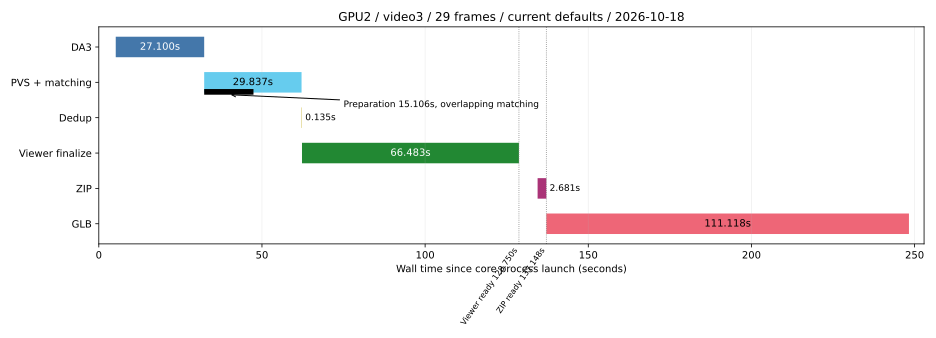

# 最新 profiling：GPU2 / video3 / 29 帧 / 2026-10-18

本文件是项目唯一当前 profiling 入口。当前本地 `main`（`bf9bde8`）的完整实测为 **248.900 秒**；Viewer 在 **128.750 秒**可用，ZIP 在 **137.148 秒**就绪，GLB 在 **248.267 秒**写入返回。正式主跑一次，使用当前默认算法。生产源码、默认参数和线上服务未修改。

本轮最值得关注的新发现是：**NN/SOR 虽然已放进准备线程，但可能持有 GIL，拖慢同时进行的 PVS 模型构建。** 时间线重叠不能直接当作等量加速；下文给出额外复现、线程 CPU 与绑定源码依据。GLB 仍占主跑约 44.6%，最终几何过滤仍占 51.404 秒。

[完整机器可读汇总](../profiling-20261018/summary.json) · [29 个 reference 明细](../profiling-20261018/references.csv) · [实验与重现入口](../profiling-20261018/README.md) · [工作日志](../../docs/work-journal/2026-10-18-profiling/JOURNAL.md)

算法细节按实际依赖拆为三份，包含伪代码、tensor/array shape、阈值、每层/每帧/每批循环、源码位置及未测边界：

- [DA3、PVS、3D matching、dedup 逐步骤实现](../profiling-20261018/algorithms_gpu_matching.md)。包括 DA3 两个 backbone 的 attention/token 循环、DPT head，以及 PVS encoder/box decoder。
- [几何准备、NN/SOR/DBSCAN/RANSAC、标签与预算采样](../profiling-20261018/algorithms_geometry.md)。包括商品保护、20% guard、背景 voxel 和自适应 scale。
- [LOD、Surfel 烘焙、长边限制、RGB 延展、atlas、ZIP/GLB](../profiling-20261018/algorithms_delivery.md)。包括 8×8 tile、页面容量、量化和最终文件布局。

## 1. 测量范围与环境

| 项目 | 本次实际条件 |
|---|---|
| 代码 | 本地 `main`，HEAD `bf9bde8`；原有 dirty 文档保留，核心生产源码无未提交差异 |
| GPU | 物理 GPU2，RTX 4090 D，24,564 MiB；UUID `GPU-d8012344-c2b6-f54b-7edc-9df3acda6fa7`；进程内逻辑 `cuda:0` |
| 共用负载 | GPU2 已有两个进程，合计 5,030 MiB，整个主窗口保持该数；未停止、迁移或修改它们；主机 CPU 也共享 |
| 输入 | `fd-videos/3.json` 对应的 29 帧、711 observations，视频时刻 0、1.5…42.0 秒 |
| 照片 | 复用 10 月 16 日从原视频还原的同一批 1080×1920 JPEG quality=95 与 canonical 检测/分类 JSON；不重新抽帧、检测、分类 |
| DA3 | `DA3NESTED-GIANT-LARGE-1.1`，snapshot `b2359bdf726fb44ef62acca04d629dcf158053e7`；29 帧一次推理；seed=42；自动相机；504×280 processed grid；metric 硬门 |
| PVS / matching | SAM3.1 PVS，box batch=4；29 refs，`pairing_3d=next` 环形；reference 串行；matching 默认 seed=42 |
| CPU / 软件 | 40 逻辑 CPU/20 物理核；OMP/OpenBLAS/MKL 环境上限=4，未固定 CPU affinity；Python 3.11.11，Torch 2.7.1+cu126，NumPy 1.26.4，Open3D 0.19.0，Pillow 12.3.0 |
| Viewer 默认 | NN/SOR raw 提前准备；DBSCAN 和 ground 开启；voxel=5 mm；商品预算 2M、背景 500K；proxy/early-background/quality/spill/single-owner 关闭 |
| GLB 默认 | compact streamed，LOD=True，radius=2，tile_size=8，palette=128，**encoder_workers=1**；已有 2/4 线程功能没有在本轮自动开启 |
| 缓存 | 新进程、新 DA3/PVS 结果目录；模型文件和 OS 页缓存保留，不做系统 drop caches；PVS 首次导入/构造发生在主请求内 |
| 起止 | 从启动 core 进程前的单调时钟，到 core、delivery 两个进程退出被观察到；含导入、模型、必要文件写入、进程退出与轮询间隙 |
| 截止产物 | 完整 Viewer generation/CURRENT、本地 ZIP、完整 GLB；文件写入返回，无 fsync 承诺 |
| 未覆盖 | detector/classifier、视频抽帧、HTTP/BSON、COS、网络下载、浏览器渲染、ground-footprint 面积计算、准确率或人工画质验收、已加载服务的热请求 |

根 `.venv` 和原 HF DA3 cache 是失效的旧 build symlink，未更改它们。本轮使用已恢复的独立 test-env；DA3 权重从项目已有本地镜像 `global-id-mapping:cos-background-20261013` 提取，同一 snapshot、约 6.3 GiB。临时容器从未启动，提取后已删除；没有下载模型。该环境准备和输入链接准备不计入主表。

## 2. 正式主跑：可相加主表与时间线

| 互斥主阶段 | 秒 | 起止 offset（秒） |
|---|---:|---:|
| DA3 重建 | 27.100 | 5.193 → 32.294 |
| PVS + matching | 29.837 | 32.295 → 62.132 |
| Dedup | 0.135 | 62.132 → 62.267 |
| 最终 Viewer / Surfel 导出 | 66.483 | 62.267 → 128.750 |
| ZIP | 2.681 | 134.467 → 137.148 |
| GLB | 111.118 | 137.149 → 248.267 |
| 导入、启动退出与未单列间隙 | 11.544 | 主总量减以上六段，含 core/delivery 导入与采样轮询 |
| **合计** | **248.900** | 主 launcher 窗口 |

四舍五入可能使表格显示值相差 0.001 秒；原始精度在 summary 中闭合。core 进程外层 130.854 秒，delivery 进程外层 118.044 秒；不能再加到主表。core 的 `run_complete_pipeline` 自身 123.578 秒，不含此前导入。

准备线程从 32.294505 到 47.400741 秒，耗时 **15.106235 秒**；与 matching 交集 **15.106026 秒**。约 0.000209 秒是提交和 matching 入口的先后差。准备在 dedup 完成前已经结束；这里没有把 `future.result()` 的执行时间单独测成一个数。

| 可用里程碑 | 从主起点算起（秒） | 含义 |
|---|---:|---|
| CURRENT 更新返回 | 128.747 | 完整 generation 已发布 |
| Viewer export 返回 | 128.750 | 调用方可以交付 Viewer |
| ZIP 写入返回 | 137.148 | 本地 ZIP 文件就绪 |
| GLB 写入返回 | 248.267 | 本地 GLB 文件就绪 |
| delivery 退出被观察到 | 248.900 | 主测量截止 |

这些是本地可用时间；未验证任何浏览器已经加载或显示。

## 3. DA3：启动、模型、推理、反投影与 NPZ

主跑重建 27.100 秒，包含独立子进程、导入、模型构建/加载、搬 GPU、推理、NPZ、子进程退出和父进程校验。主跑内可直接观察到：DA3 导入 5.641 秒，`from_pretrained` CPU 区间 13.445 秒，inference API 2.864 秒，CPU 反投影 0.095 秒，`np.savez` 函数内 0.204 秒；这些并不覆盖全部重建操作。

下表来自独立细分，窗口 **22.398 秒**，不替换主跑 27.100 秒：

| 独立 DA3 子步骤 | wall 秒 | 做什么 / 边界 |
|---|---:|---|
| Torch/NumPy 导入 | 1.468 | 诊断窗口内导入 |
| DA3 依赖/模型模块/runner 导入 | 2.865 | 含 AST 插桩模块准备 |
| 29 张 JPEG decode/RGB | 0.501 | runner 图像列表构造 |
| 网络构造 | 11.409 | CPU 创建两分支及 head，含参数默认初始化 |
| safetensors load_model 总区间 | 0.798 | 含 load_file、assignment 和校验，子项不再加 |
| ↳ load_file 打开/映射 | 0.085 | 不等于完整物理磁盘读取 |
| ↳ state assignment | 0.563 | 逐 tensor 赋值，可能触发 mmap 页读取 |
| 模型 `.to(cuda)` | 1.879 | 原生调用的 wall，没有额外同步 |
| 图片 preprocess | 0.182 | resize、normalize、stack |
| H2D / 输入整理 | 0.012 | 主机提交与整理，不是 completed-copy CUDA 时间 |
| forward 原生同步区间 | 2.220 | 保留原有前后 synchronize，含 CPU 调度 |
| 输出转 Prediction / D2H | 0.015 | 输出落为 CPU 数组 |
| processed RGB 整理 | 0.169 | NHWC、反归一化、clip、uint8 |
| CPU 深度反投影 | 0.092 | 逐 29 帧 `K^-1 p d`，再 C2W |
| NPZ 序列化/写入函数内 | 0.210 | 未压缩 np.savez，无 fsync |
| NPZ 整条保存语句 | 0.246 | 包含参数 `.astype()` 等求值，覆盖上一行 |

不能把 11.409 秒网络构造叫作“读权重慢”。Nested 顺序执行 anyview、metric，再做尺度对齐；不是 29 次独立重建。DA3 grid 为 `[29,504,280]`，共 4,092,480 个位置。

CUDA events 单列如下；它们来自同一独立诊断，属于 stream elapsed，包含嵌套与可能的 CPU enqueue 间隙，不等于独占 kernel 总时间：

| DA3 CUDA event 区间 | 秒 | 包含关系 |
|---|---:|---|
| Nested forward | 2.219 | 父区间 |
| anyview 分支 | 1.778 | Nested 子区间 |
| ↳ anyview backbone | 1.328 | anyview 子区间 |
| metric 分支 | 0.436 | Nested 子区间 |
| ↳ metric backbone | 0.156 | metric 子区间 |
| metric scaling | 0.000274 | Nested 子区间 |
| depth alignment | 0.003913 | Nested 子区间 |
| sky handling | 0.000978 | Nested 子区间 |

事件在原生 forward 同步和 Prediction D2H 之后读取，没有逐层新增 synchronize。详细构造、attention/token 数、四层特征和 DPT chunk 循环见 [GPU 算法文](../profiling-20261018/algorithms_gpu_matching.md)。

## 4. Matching / PVS：每个 reference 实际做什么

主跑 matching 总量 29.837 秒。`next` 每个 ref 仅匹配下一帧，最后一帧回到第 0 帧；共 29 对，不是 29×28。现有全局 RNG lock 序列化 reference 的关键路径，不能把增加 reference worker 数当作既有匹配并行度。

| 主跑内部区间 | 秒 | 次数 / 含义 |
|---|---:|---|
| SAM masks 总区间 | 24.795 | 29 refs，包含下列三项 |
| ↳ 首次 PVS 模型加载 | 20.118 | 与准备线程重叠，不是 GPU forward |
| ↳ PVS predict API 合计 | 4.322 | 29 张图、711 框 |
| ↳ 其余 mask/cache 包装差额 | 0.355 | cache lookup/校验/发布等未再逐项测量 |
| 参考 mask 点采样 | 1.056 | 711 次，每物体最终最多70点 |
| world→camera | 0.120 | 697 次，含 `.item()` 等等待 |
| 3D→2D 投影 | 0.236 | 697 次 |
| 投影后处理 | 0.199 | 697 次 |
| 目标 bbox 命中/验证/选择 | 1.681 | 697 次，目标 bbox 采样、SVD 与候选评分 |
| 数据加载 | 0.203 | 29 次 |
| transforms 构造 | 0.005 | 29 次 |
| 场景数据构造 | 0.163 | 首 ref 的 Tensor 构造，不能覆盖全部 NPZ 数组解包 |
| 结果后处理 | 0.014 | 29 次 |

`process_images`、`per_ref_total`、`batch_all_refs_total` 是嵌套父区间，不能再相加；未列工作留在 matching 总量中。`cache_npz_load=0.000279s` 只测 `np.load()` 打开 archive，不能据此说完整 NPZ 读取耗时如此；`mask_postprocess` 是当前空 span，不作为有效后处理计时。

主跑 PVS native metrics：encoder 合计 **2.088 秒**，inference_and_postprocess **3.742 秒**；后一项包含前者和 stack，不能相加。ref0 总 wall 21.316 秒包含首次模型准备；之后每 ref 的 0.155–0.421 秒与框数有关，**不代表已加载服务的完整热请求**。[全部29行](../profiling-20261018/references.csv) 保留各 ref 的 wrapper/predict/encoder 与框数。

独立 PVS 细分：18.157 秒窗口，model load 8.053 秒、29 帧 predict 4.279 秒。模型内部构造 6.428 秒、modelbuilder 导入 0.780 秒、checkpoint mmap 0.149 秒、strict assignment 0.210 秒、eval/to 0.429 秒。图像 transform/H2D 语句合计 0.431 秒；另从 JPEG BICUBIC resize 到 processed grid 为 1.170 秒。

独立 PVS CUDA events：29 次 encoder **2.063 秒**，187 次 decoder batches **1.440 秒**；encoder/decoder host call 分别为 1.111/1.428 秒。host 返回可能早于 GPU 完成，不能用 host 与 event 相减得到“纯 CPU 时间”。没有重放 matching 的 prompt reorder、RNG 保存恢复、cache 发布和 next-ref prefetch；这里只支持组件归因，不支持 mask 逐像素等价或新增准确率结论。

## 5. 新发现：准备线程与 PVS 构建存在 GIL 并行限制

一次额外 **30 秒硬上限**的初始化复现只做 prepare + PVS load，不 predict、不发布文件，也不跑完整流水线；24.111 秒内成功结束。

| 区间 | 独立 PVS 诊断 wall | 重叠复现 wall | 重叠复现当前线程 CPU |
|---|---:|---:|---:|
| PVS 模型加载 | 8.053 s | 19.307 s | 8.511 s |
| 其中模型构造 | 6.428 s | 17.362 s | 6.607 s |
| checkpoint mmap | 0.149 s | 0.154 s | 0.153 s |
| assignment | 0.210 s | 0.220 s | 0.219 s |
| eval/to GPU | 0.429 s | 0.534 s | 0.532 s |
| prepare 总量 | 未运行 | 14.948 s | 14.501 s |
| 其中 NN 整段 | 未运行 | 3.791 s | 3.729 s |
| 其中 SOR 原生调用 | 未运行 | 6.121 s | 6.010 s |

这次可将膨胀定位到**模型构造阶段**，没有证据说多出的时间主要花在读权重。当前线程 CPU 不包括 Torch/OpenMP 工作线程，不能把 wall−thread CPU 直接命名为 GIL 等待。

进一步依据：

- 名义 200 ms 的 Python 采样器出现 **3.903 秒、6.155 秒**空档；其间主构建线程仅运行约 0.103/0.049 秒 CPU，runqueue 等待仅约 0.000061/0.000069 秒。线程栈在 PyTorch 参数初始化与后台 NN/SOR 附近。这不像把整个差额都解释为主线程抢不到 CPU。
- 固定版本 [Open3D 0.19.0 pybind 绑定](https://github.com/isl-org/Open3D/blob/v0.19.0/cpp/pybind/geometry/pointcloud.cpp#L126) 对 NN/SOR 直接绑定 C++ 方法，没有 GIL release guard；[pybind11 的 GIL 规则](https://pybind11.readthedocs.io/en/stable/advanced/misc.html#global-interpreter-lock-gil)说明这种绑定不会自动释放 GIL。C++ 内部是否有 OpenMP 并行，与其他 Python 线程能否继续执行是两件事。
- 因而 **GIL 阻塞有固定版本源码机制支持，并与本机复现时序相符**。仍未使用专门的 GIL 等待探针，也未审核安装 wheel 的机器码；不能把主跑全部 12.065 秒差额精确归于某把锁，更不能宣称一定可回收这些时间。

重叠复现没有此前 DA3 子进程、matching scene H2D、reference 数据准备与 prefetch，OS 页缓存也不同。这里支持调查机制，**不是受控的全链路提速比较**。下一步应优先验证 NN/SOR 的进程隔离或原生释放 GIL，而非继续扩大 ThreadPool。新 worker 带来的输入搬运、Open3D cloud 重建、内存与错误传播成本尚未测量，本轮没有修改这项架构。

## 6. Dedup：union-find、分类聚合与发布

主跑 **0.135 秒**。独立诊断 **0.137 秒**：parse summaries 0.003、build_global_mapping 0.022、add_global_id_to_jsons 0.033、原子发布 global pair 0.026 秒；剩余为检测读取、metadata 聚合、逐帧输出与包装。

全部 711 `(image_id,object_idx)` 初始化为 union-find nodes；按边的 hit ratio 处理。同一组件不能含同一图片的两个检测，因此有冲突时拒绝 union。合并后按顺序分配 global ID；最终逐帧 survivor 与 global mapping 共享决策，聚合 classification/SKU metadata，再发布 JSON。本次得到 **385 global IDs / 711 observations**。数量齐全不等于准确率验收。

## 7. Surfel 准备与最终导出：当前主跑细分

| 准备线程主跑子项 | 秒 | 工作 |
|---|---:|---|
| 读/校验 DA3 cache | 0.206 | 全 native grid |
| U/V/depth | 2.021 | 两个轴的邻接差分与深度连续性 |
| raw filter 准备 | 11.596 | float64 snapshot、Open3D、NN、SOR raw mask；NN整段3.542s已在其中 |
| 源照片/相机纹理 | 1.043 | 29 张 JPEG 与相机 metadata |
| 其余准备 | 0.239 | 有效域、索引、输入关联、返回结构等差额 |
| **准备合计** | **15.106** | 与 matching 重叠；不能另加进主表 |

| 最终导出主跑子项 | 秒 | 说明 |
|---|---:|---|
| thumbnails | 1.649 | 711 observations |
| 场景方向 | 2.696 | 本次新cache，独立于几何过滤的ground |
| `_sample_points` 总段 | 57.555 | 包含以下三项及其余采样 |
| ↳ masks→实例标签 | 0.205 | canonical processed PVS masks |
| ↳ 最终几何过滤 | 51.404 | 复用raw NN/SOR，应用保护/guard，再DBSCAN与ground |
| ↳ 背景 voxel | 1.025 | 5 mm，置信度优先 |
| ↳ 其余采样工作 | 4.921 | features、预算、adaptive选择、scale、稳定排序等差额 |
| `prepare_surfels` | 0.221 | U/V/scale/depth序列化，复用JPEG |
| point ranges | 3.862 | 对各observation查label半开范围 |
| generation 发布 | 0.120 | 二进制/JSON/JPEG及CURRENT |
| 其他最终导出工作 | 0.380 | bounds/居中/objects/manifest等差额 |
| **最终导出合计** | **66.483** | 主跑范围 |

上表互斥差额只在其本次父窗口内计算；不能把下一节独立诊断的子项填入本表。

## 8. 几何过滤独立细分、点数与随机性

独立 Viewer 诊断总窗口 **82.655 秒**，串行 prepare **14.159 秒**、finalize **64.838 秒**，另外包含 imports 和独立 dedup；此运行不测 matching 重叠。

| 原生 / 外层步骤 | 秒 | 次数 / 域 |
|---|---:|---|
| 初始 NN 原生 | 3.323 | 1次，4,092,480点；整段含median为3.360s |
| SOR 原生 | 5.739 | 1次，原始全有效域；k20/std2 |
| SOR结果应用整段 | 0.761 | 商品保护、20% guard、selection；不含提前native SOR |
| DBSCAN 原生 | 38.728 | 1次，SOR保护后3,889,210点 |
| DBSCAN外层整段 | 39.498 | 含native、簇门槛、保护、selection |
| ground RANSAC 原生 | 10.518 | 1次，3,425,675点，dist=.02m，最多1000次假设 |
| ground外层整段 | 11.260 | 含native、双侧判断、保护、selection |
| 三次pcd select合计 | 1.851 | 已包含于上面三个外层步骤，不能再加 |
| 最终filter总段 | 51.696 | 包含后三个阶段及校验等，不包含提前NN/SOR |

方向拟合另有 NN **0.132 秒**、RANSAC **1.188 秒/2次**，方向 fitter **1.355 秒**；输入最多200,000点，和上述地面删除不是同一工作。

### 商品保护到底保住了多少点

下表仅为独立 Viewer 诊断的实际记录，所有阶段20% guard均未触发：

| 步骤 | 输入点 | raw规则保留 | 被保护额外保回 | 应用后点 |
|---|---:|---:|---:|---:|
| SOR | 4,092,480 | 3,888,385 | 825 | 3,889,210 |
| DBSCAN | 3,889,210 | 3,402,853 | 22,822 | 3,425,675 |
| ground | 3,425,675 | 3,120,648 | 246,927 | 3,367,575 |

初始 median NN=**0.003933914 m**；DBSCAN eps≈**0.019669572 m**，min_points=10，簇门槛为本阶段1%。商品点1,902,589全部保留；filter后背景1,464,986，voxel后背景候选1,097,823，再选500,000。商品不超过2M，全部保留，但仍计算adaptive scale。

主跑 filter 输出是 **3,425,675**，独立诊断是 **3,367,575**。两者最终都是2,402,589点；**总点数相同不证明来源或画面相同**。当前 Open3D RANSAC没有在本流程显式seed；随机平面、候选和guard阈值可能改变背景/方向结果。主跑没有逐阶段mask/inlier记录，不能声称已精确证明主跑ground为什么未减少同样数量；独立计数不能补写成主跑计数。

Python只调用native接口。KD-tree建树、逐点邻域搜索、DBSCAN串行扩展、RANSAC实际迭代数量没有分别实测；[原生循环说明](../../docs/viewer_export_algorithm.md#61-open3d-0190-原生循环)解释实现，不冒充子阶段计时。

## 9. 最终用多少点、为何仍保留全 grid

| 主跑阶段 | 点/元素 |
|---|---:|
| DA3 native / export-valid | 29×504×280 = 4,092,480 |
| 最终几何过滤后 | 3,425,675 |
| SAM商品 / 背景预算后 | 1,902,589 / 500,000 |
| **Viewer Surfel实例** | **2,402,589** |
| GLB保守2×2 LOD后 | 1,297,845 |
| GLB实际烘焙后 | 1,282,900 |
| GLB跳过无有效纹理候选 | 14,945 |
| GLB三角形 / atlas页 / primitives | 2,565,800 / 31 / 93 |

Viewer与GLB使用不同的最终表示。GLB LOD不会回写Viewer点集。完整depth `[29,504,280]`仍保留，用来判断真实深度断裂和纹理遮挡；它不是2,402,589个选点长度的数组。

NN/SOR/DBSCAN/ground属于当前清理策略，并非生成Surfel的数学必要条件。生成需要位置、局部U/V、来源图像/相机与depth支持。可以调查提前缩背景候选，但这会改变邻域、密度、连通和地面判断；当前实验开关仍默认关闭，本次没有DBSCAN-off/proxy/early-background画质或提速验收。

## 10. ZIP：8个二进制压缩，图片不重编码

主跑 **2.681 秒**。独立诊断 **2.879 秒**，751个成员：

| 类别 | 成员数 | 未压缩字节 | 归档payload字节 | 成员write区间合计 |
|---|---:|---:|---:|---:|
| `.bin` | 8 | 92,275,575 | 54,662,821 | 2.731s |
| JPEG（29纹理+711缩略图） | 740 | 24,756,111 | 24,756,111 | 0.120s |
| JSON | 3 | 233,431 | 233,431 | 0.001s |

时间使用嵌套timer统计，不含记录每成员元数据的小开销；JSON/JPEG为STORED，二进制DEFLATE level1，整体write包含读文件/压缩/写ZIP，不是纯zlib。最终主跑ZIP **79,733,167 bytes / 76.039 MiB**。ZIP没有CURRENT/runs外层、GLB，也没有本次未提供的SKU masterdata。

## 11. GLB：当前切片RGB后的详细循环与成本

主跑 **111.118 秒**。生产report中的bake/LOD/输入整理等为 **66.421 秒**，主线程compact/encode/write为 **44.695 秒**；默认串行编码，其中编码调用总量 **42.882 秒**，其余主线程量化/metadata/BIN/最终写 **1.813 秒**。编码join、bake和compact的包含关系见算法文；不能再把join加到44.695上。

下表是对**主跑同一generation**做的独立CPU诊断，GLB **110.956 秒**：

| 步骤 | 秒 | 循环/包含关系 |
|---|---:|---|
| 输入读取/校验 `_load` | 0.180 | 同一generation目录 |
| 保守2×2 LOD | 5.145 | 452,666个eligible blocks；368,248个通过合并 |
| ↳ coverage检查 | 1.615 | 72批，每批最多8192组，不再加到LOD |
| `_bake_batch`总段 | 59.624 | 1,280批，默认最多1024个候选/批 |
| ↳ 相机/中心可见性 | 0.491 | 连续AST block |
| ↳ 初始footprint及四邻深度连续性 | 1.122 | 含_bound_footprint 0.380s |
| ↳ radius/scale及最终直径限制 | 0.530 | 含_limit_final_diameter 0.462s |
| ↳ 8×8 texel投影/圆盘与边界mask | 11.860 | 批向量化world→camera→processed |
| ↳ source depth/来源图像/面积判定 | 5.312 | 去掉完全没有有效texel的Surfel |
| ↳ source→texture及双线性RGB | 15.904 | 含_bilinear 15.544s |
| ↳ tile/corners/RGB延展 | 24.272 | 含_dilate_rgb 22.717s |
| atlas页面组装 | 0.620 | 31页；默认10×10 tile含gutter，每满页41,616个Surfel |
| 几何量化/写BIN | 1.718 | 含bufferView；16-bit位置/UV/index |
| atlas编码总段 | 42.234 | 以下三项及包装的父区间 |
| ↳ alpha二值检查 | 0.997 | 31页 |
| ↳ MEDIANCUT调色板 | 18.622 | 128色，含透明区RGB，无dither |
| ↳ PNG save | 21.540 | optimize=True |
| 图片字节写BIN | 0.034 | 无重新解码 |
| 最终GLB拼装/写入 | 0.082 | 121,211,016 bytes |

bake七个连续block合计59.491秒，剩余为函数包装与语句间开销；不要同时累加七block及其中子函数。上表仍有照片decode/convert、页面迭代、文档/材质整理等未单列工作，保留在GLB父区间中。

实际循环是 frame → 每1024候选bake → 有效10×10 RGBA tile → 每41,616个组atlas → 编码 → geometry/image/material顺序写BIN → 最终GLB。透明RGB延展保持alpha，按固定四方向、旧轮known传播，不能直接删除后声称画面不变。

两道footprint限制均保留：初始归一化footprint限制椭圆过长/过扁；乘radius/scale后再限制最终长直径≤**6×native最大间距**。本轮没有放宽Surfel长边来换性能。

## 12. 显存、RAM、CPU与产物

| 指标 | 本次观测 | 口径 |
|---|---:|---|
| GPU任务driver采样峰 | **15,132 MiB = 14.777 GiB** | 200ms采样，按本次实际进程树PID筛选、同一时点求和，排除已有进程 |
| GPU2整卡采样峰 | 20,181 MiB = 19.708 GiB | 包含5030MiB已有进程和驱动开销 |
| DA3 allocated / reserved peak | 11.410 / 14.363 GiB | DA3子进程生命周期PyTorch allocator峰，分别记录、不相加 |
| Core/PVS allocated / reserved peak | 3.112 / 3.285 GiB | core进程生命周期峰，与DA3峰不同时 |
| Core树RSS采样和峰 | **13.840 GiB** | uv/core/DA3子进程同时RSS和；共享页可能重复计；不含launcher及nvidia-smi |
| Delivery树RSS采样和峰 | 0.930 GiB | 同上定义 |
| 单进程RSS高水位 | DA3 13.888、Core 5.423、Delivery 0.893 GiB | Linux ru_maxrss，不是同时总峰，也不是阶段增量 |
| 进程生命周期CPU | DA3 29.072、Core 193.744、Delivery 259.331 CPU秒 | user+system；允许多线程CPU秒大于wall；不包含所有短命wrapper/监控成本 |
| generation / ZIP / GLB | 111.833 / 76.039 / 115.596 MiB | 本地文件大小；GLB=121,211,016 bytes |

GPU采样有效1243个整卡时点，覆盖248.777秒；主窗口248.900秒，两端不足一个采样周期。短峰可能漏掉。driver显存、allocator allocated/reserved和RSS是不同指标；不能相减两个不同时间的peak来推断某时刻缓存占用，不能跨进程将历史最大值相加。

独立组件的RSS HWM为DA3约13.803GiB、PVS4.686GiB、Viewer3.519GiB、delivery0.899GiB；这些诊断窗口不是主跑资源峰，也不相加。详细机器值以各result.json为准。

## 13. 旧内容替换、验证与未完成项

10月16日GPU0的267.565秒退出当前基线。旧入口原文保存为[历史快照](../../runtime/profiling-20261018/previous-profiling_breakdown.md)，旧原始产物保留；先前RGB/atlas对照作为各自条件下的历史实验，不再混入本轮主表。

两次历史观测的账面差：总248.900−267.565=**−18.665秒**；Viewer128.750−121.214=**+7.536秒**。GPU显存容量、代码、页缓存及共享负载不同，这不是受控加速率。不能只展示完整GLB减少，却隐藏Viewer反馈变晚。

已完成：一轮完整主跑，DA3/PVS/Viewer与dedup/delivery四类独立细分，一次有界初始化重叠复现；三个medium subagents协作，协调者执行GPU2任务。脚本做了必要的syntax/AST/import wiring smoke，全部真实测量正常结束。第一次preflight因canonical JSON计数取错层级，在启动模型前失败，修正后重跑；失败日志保留，没有把它算成性能样本。

本轮只新增诊断脚本/报告、更新文档，没有生产算法改动，因此没有重复跑全量pytest、browser benchmark或额外hash/CRC矩阵。未完成热服务请求、多视频分布、浏览器视觉、精确GIL等待分摊、Open3D native内部建树/查询/扩展各子段计时；未证明近似过滤或进程隔离的收益。现有GPU任务与服务保留，测量结束后本任务无GPU作业残留。

后续先验证两条有实测依据的方向：NN/SOR的GIL隔离与主请求关键路径，以及在新generation上显式开启已有atlas两worker的完整交付收益。DBSCAN仍值得做关闭/代理点视觉对照，但本轮没有用删除清理步骤或放宽长边限制获得这些数字。
