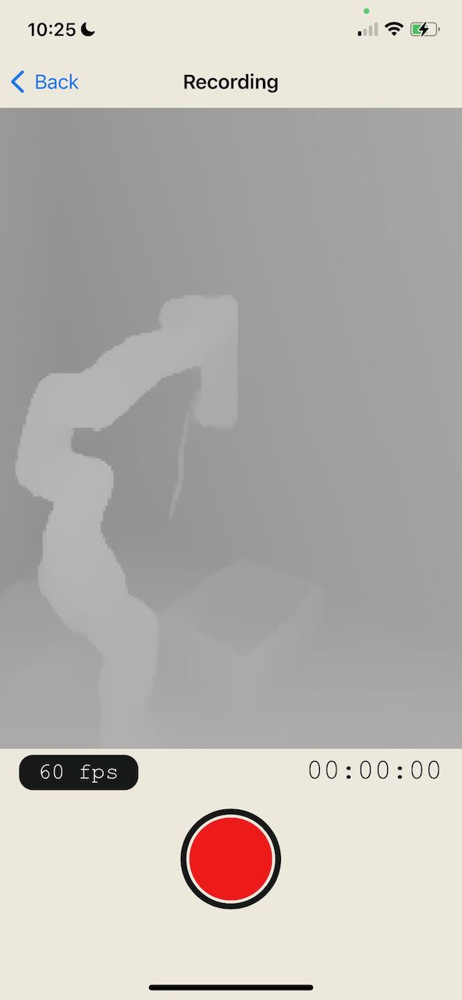

# SKU Scanner：项目采集版本

基于 [Stray Robots / Scanner](https://github.com/strayrobots/scanner) 的 MIT 源码，
基准提交为 ec3e1dc9d33f8df2289ede6a5c59f7991d1a6bbb，开发机独立 checkout 分支为 sku-workflow；本目录随主项目 main 以普通源码文件发布。
当前版本在持续 ARKit tracking 下，每个真实经过的秒保存第一组跟踪稳定、数据齐全的
RGB + LiDAR + confidence + K/c2w。手机保存原始 RGB 尺寸和原生 LiDAR 网格。
数据通过本地 ZIP 导出，服务端直接读取 PNG；包格式见 [sku_bundle.md](docs/sku_bundle.md)。

## 在 Mac 上构建

当前主机为 Linux，尚未运行 Xcode 编译、XCTest 或 iPhone 真机采集。
下面是需要在 Mac 上执行的步骤；本目录不包含可安装的 IPA。
在当前项目中进入 sources/stray-scanner；若使用交付的源码 ZIP，解压后进入其中的 stray-scanner 目录。
Git checkout 的 PNG 资源由 Git LFS 管理：先安装 Git LFS，并在主项目根目录执行 git lfs pull，
再进行下述构建。开发机交付的源码 ZIP 已包含实际资源文件。

```bash
cd sources/stray-scanner
pod install
open StrayScanner.xcworkspace
```

选中 StrayScanner scheme 和配备 LiDAR 的真机，在 Signing & Capabilities
选择自己的 Apple Development Team，并把 com.skuworkflow.scanner 改为自己的唯一 Bundle ID。
原作者的签名 Team 已清空。保留上游主 target 的 iOS 18.6 最低版本要求，
使用具备相应 SDK 的 Xcode。相机权限由首次进入采集页时申请。

停止、返回或切到后台时会先排空写入队列并完成包；后台执行时间耗尽、强制杀进程或掉电时，
未完成包保持 recording 状态，不能作为 ready 包导入。
详情页显示第一张原图，点击“导出数据包”后用 AirDrop 或“存储到文件”导出 ZIP。

## 进入现有重建流程

在 3D_Recognization 根目录，将 ZIP 解压后指向包含 scan_bundle.json 的 .rgbd 目录：

```bash
uv run python scripts/3d/scanner/prepare_bundle.py \
  /path/to/sku-scan.rgbd Output/scanner_bundle_prepared

uv run python scripts/3d/scanner/reconstruct.py \
  --base Output/scanner_bundle_prepared --candidate promptda \
  --promptda-repo runtime/PromptDA \
  --checkpoint runtime/models/promptda/vitl/model.ckpt \
  --output Output/scanner_bundle_promptda --device cuda:0
```

服务端沿用默认1008长边、FP16 autocast、batch size 2。DA3 + K/E 的同一 prepared 输入
及完整命令见 [项目 Scanner 入口](../../scripts/3d/scanner/README.md)。

## 检查

原生 PNG 编码可在 Linux 或 Mac 独立验证：

```bash
g++ -std=c++11 -O2 -I StrayScanner/CCode \
  tests/RgbdPngTest.cpp StrayScanner/CCode/lodepng.cpp \
  -o /tmp/sku-scanner-png-test
/tmp/sku-scanner-png-test
```

Mac 上使用 StrayScanner scheme 的 Test，或指定本机可用的 simulator UUID：

```bash
xcodebuild -workspace StrayScanner.xcworkspace -scheme StrayScanner \
  -destination 'platform=iOS Simulator,id=<SIMULATOR-UUID>' \
  CODE_SIGNING_ALLOWED=NO test
```

XCTest 共6项，覆盖录制按钮重复布局、真实时间采样、缺失数据重试、时间倒退、相机轴和 row-major JSON。
真机需另外检查：移动约1米时的位姿平移、朝向已知平面的深度、原图与 LiDAR 边缘对齐、
旋转手机后导出仍保持 raw image 方向、停止录制后 ZIP 的帧数，以及后台中断后的状态。
CPU/语法检查不能代替这些采集和 SDK 检查。

上游 [LICENSE.md](LICENSE.md) 及版权声明保留；应用的说明页也包含完整 MIT 声明。

## 上游原始说明（历史格式）

以下介绍对应上游的全帧 MP4 格式。当前项目版使用上面的 RGB-D bundle 入口。

The goal of this app, is to allow easy access to raw RGB-D video datasets recorded using LiDAR enabled iOS devices. The app can be downloaded for free [on the iOS App Store](https://apps.apple.com/us/app/stray-scanner/id1557051662).



## Usage

Documentation can be found under the [docs](docs/) directory. The document [docs/format.md](docs/format.md) describes the data format and conventions used in the app.

## Related projects

- [StrayVisualizer](https://github.com/kekeblom/StrayVisualizer): a project to visualize the raw data collected by the app
- [MATLAB Scripts](https://github.com/PyojinKim/StrayScannerVisualizer): a set of tools to work with the data format in Matlab
- [Autolabel](https://github.com/ethz-asl/autolabel): an interactive volumetric labeling tool

## Contributing

Contributions are welcome. To contribute, simply open a pull request.

Some ideas for improvements include:
- Better scan viewer
- Better ways to organize scans, e.g. through tags
- Recording other modalities, such as audio, Wifi or GPS
- Direct upload to cloud services or S3

